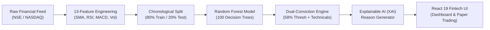
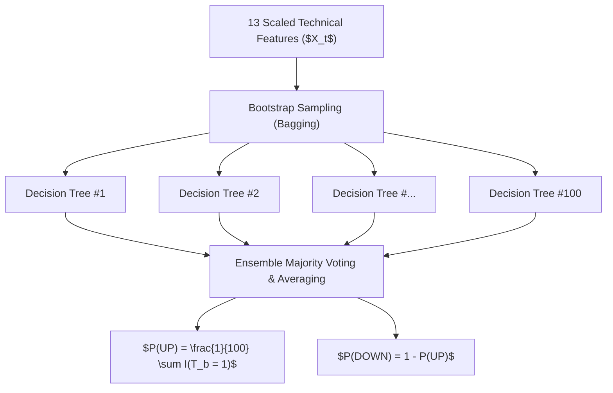
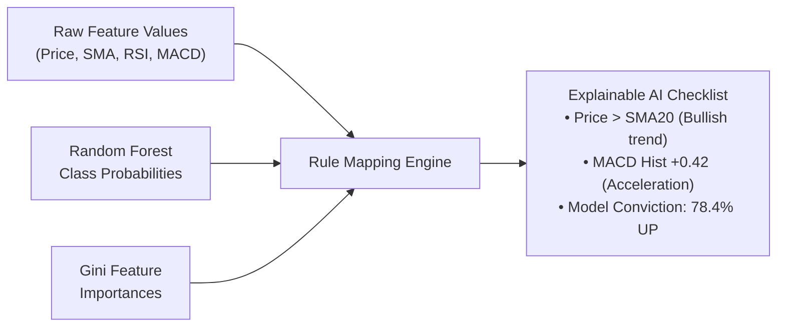
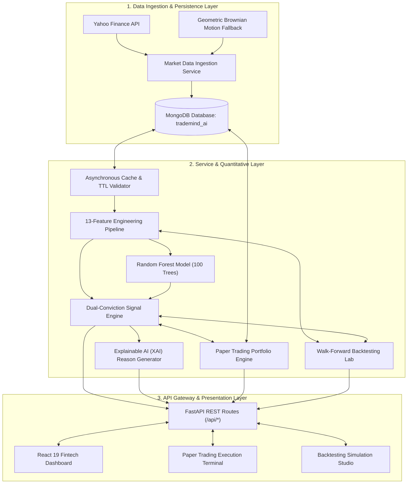

# VISVESVARAYA TECHNOLOGICAL UNIVERSITY
### “JNANA SANGAMA”, BELAGAVI – 590 018, KARNATAKA

---

<br>

<div align="center">

# Major Project Phase-II (BIS786) Report
### on

## **“INTELLIGENT TRADING BOT WITH REAL-TIME MARKET DATA ANALYSIS”**

<br>

*Submitted in partial fulfillment of the requirements for the award of the degree of*

### **BACHELOR OF ENGINEERING**
### in
### **INFORMATION SCIENCE AND ENGINEERING**

<br>

**Submitted By:**

| Student Name | University Seat Number (USN) |
| :--- | :--- |
| **YASHWANTH GOWDA H** | **1SV21IS058** |
| **TEAM MEMBER 2** | **1SV21IS---** |
| **TEAM MEMBER 3** | **1SV21IS---** |
| **TEAM MEMBER 4** | **1SV21IS---** |

<br>

**Under the Guidance of:**

**[Guide Name]**  
*Designation, Department of Information Science and Engineering*  
*Sai Vidya Institute of Technology, Rajanukunte, Bengaluru – 560 064*

<br>

---

### **DEPARTMENT OF INFORMATION SCIENCE AND ENGINEERING**
# **SAI VIDYA INSTITUTE OF TECHNOLOGY**
*(Affiliated to Visvesvaraya Technological University, Belagavi | Approved by AICTE, New Delhi | Recognized by Govt. of Karnataka)*  
**Accredited by NBA, New Delhi (CSE, ISE, ECE) | Accredited by NAAC with ‘A’ Grade**  
**RAJANUKUNTE, BENGALURU – 560 064**  
**ACADEMIC YEAR: 2026 – 2027**

</div>

---
<div style="page-break-after: always;"></div>

# SAI VIDYA INSTITUTE OF TECHNOLOGY
### RAJANUKUNTE, BENGALURU – 560 064
*(Affiliated to Visvesvaraya Technological University, Belagavi | Recognized by Govt. of Karnataka | Approved by AICTE, New Delhi)*  
**Accredited by NBA, New Delhi (CSE, ISE, ECE) | Accredited by NAAC with ‘A’ Grade**  
### **DEPARTMENT OF INFORMATION SCIENCE AND ENGINEERING**

---

<div align="center">

## **CERTIFICATE**

</div>

<br>

This is to certify that the Project Phase-II (BIS786) work entitled **“INTELLIGENT TRADING BOT WITH REAL-TIME MARKET DATA ANALYSIS”** is a bonafide work carried out by:

<div align="center">

| Student Name | University Seat Number (USN) |
| :---: | :---: |
| **YASHWANTH GOWDA H** | **1SV21IS058** |
| **TEAM MEMBER 2** | **1SV21IS---** |
| **TEAM MEMBER 3** | **1SV21IS---** |
| **TEAM MEMBER 4** | **1SV21IS---** |

</div>

students of **Sai Vidya Institute of Technology, Bengaluru**, in partial fulfillment for the award of the degree of **Bachelor of Engineering in Information Science and Engineering** of **Visvesvaraya Technological University, Belagavi**, during the academic year **2026–2027**. 

It is certified that all corrections and suggestions indicated during Internal Assessment reviews have been duly incorporated into this report deposited in the departmental library. The Project report has been approved as it satisfies the academic requirements prescribed by the University for Project Phase-II (BIS786).

<br><br><br>

<table width="100%" style="border: none; border-collapse: collapse;">
  <tr style="border: none;">
    <td align="left" style="border: none; width: 33%;">
      ___________________________<br>
      <b>[Guide Name]</b><br>
      Project Guide<br>
      Dept. of IS&E, SVIT
    </td>
    <td align="center" style="border: none; width: 34%;">
      ___________________________<br>
      <b>Dr. Amogh Pramod Kulkarni</b><br>
      Associate Professor & HOD<br>
      Dept. of IS&E, SVIT
    </td>
    <td align="right" style="border: none; width: 33%;">
      ___________________________<br>
      <b>Dr. Manjunath T N</b><br>
      Principal<br>
      SVIT, Bengaluru
    </td>
  </tr>
</table>

<br><br>

**External Viva Examination:**

**Name of the Examiners:** &nbsp;&nbsp;&nbsp;&nbsp;&nbsp;&nbsp;&nbsp;&nbsp;&nbsp;&nbsp;&nbsp;&nbsp;&nbsp;&nbsp;&nbsp;&nbsp;&nbsp;&nbsp;&nbsp;&nbsp;&nbsp;&nbsp;&nbsp;&nbsp;&nbsp;&nbsp;&nbsp;&nbsp;&nbsp;&nbsp;&nbsp;&nbsp;&nbsp;&nbsp;&nbsp;&nbsp;&nbsp;&nbsp;&nbsp;&nbsp;&nbsp;&nbsp;&nbsp;&nbsp;&nbsp;&nbsp;&nbsp;&nbsp;&nbsp;&nbsp;&nbsp;&nbsp;&nbsp;&nbsp;&nbsp;&nbsp;&nbsp;&nbsp;&nbsp;&nbsp;&nbsp;&nbsp;&nbsp;&nbsp; **Signature with Date:**

1. _____________________________________________ &nbsp;&nbsp;&nbsp;&nbsp;&nbsp;&nbsp;&nbsp;&nbsp;&nbsp;&nbsp;&nbsp;&nbsp;&nbsp;&nbsp;&nbsp;&nbsp;&nbsp;&nbsp;&nbsp;&nbsp; _____________________________

2. _____________________________________________ &nbsp;&nbsp;&nbsp;&nbsp;&nbsp;&nbsp;&nbsp;&nbsp;&nbsp;&nbsp;&nbsp;&nbsp;&nbsp;&nbsp;&nbsp;&nbsp;&nbsp;&nbsp;&nbsp;&nbsp; _____________________________

---
<div style="page-break-after: always;"></div>

# ACKNOWLEDGEMENT

The completion of this major project brings with it a deep sense of satisfaction, academic accomplishment, and gratitude. It is never completed without thanking the persons who are all responsible for its successful completion.

First and foremost, we wish to express our deep and sincere feelings of gratitude to our institution, **Sai Vidya Institute of Technology**, for providing us with an opportunity to pursue our engineering education in a supportive and resource-rich environment.

We would like to thank the **Management** and **Prof. M R Holla**, Director, Sai Vidya Institute of Technology, for providing the necessary infrastructure, facilities, and encouragement.

We are sincerely thankful to **Prof. A M Padma Reddy**, Additional Director, Sai Vidya Institute of Technology, for his constant support, mentorship, and motivation throughout our academic journey.

We extend our deep sense of sincere gratitude to **Dr. Manjunath T N**, Principal, Sai Vidya Institute of Technology, Bengaluru, for having permitted us to carry out the project work on **“INTELLIGENT TRADING BOT WITH REAL-TIME MARKET DATA ANALYSIS”** successfully.

We express our heartfelt sincere gratitude to **Dr. Amogh Pramod Kulkarni**, Associate Professor and HOD, Department of Information Science and Engineering, Sai Vidya Institute of Technology, Bengaluru, for his valuable suggestions, technical insights, and continuous support.

We express our sincere gratitude to **[Guide Name]**, Designation, Project Guide, Department of Information Science and Engineering, Sai Vidya Institute of Technology, Bengaluru, for their constant guidance, constructive criticism, and patient support during all phases of this project.

Finally, we would like to thank all the Teaching, Technical faculty, and supporting staff members of the Department of Information Science and Engineering, Sai Vidya Institute of Technology, Bengaluru, as well as our parents, family members, and friends for their constant encouragement and assistance throughout this work.

<br>

<div align="right">

**Yashwanth Gowda H (1SV21IS058)**  
**Team Member 2 (1SV21IS---)**  
**Team Member 3 (1SV21IS---)**  
**Team Member 4 (1SV21IS---)**  

*Department of Information Science and Engineering*  
*Sai Vidya Institute of Technology, Rajanukunte, Bengaluru – 560 064*

</div>

---
<div style="page-break-after: always;"></div>

# ABSTRACT

Financial equity markets generate vast streams of high-frequency time-series data, presenting severe cognitive barriers and risk exposure for retail market participants, students, and quantitative researchers. While institutional trading houses deploy proprietary algorithmic models, these systems operate as opaque "black boxes" that obscure the predictive logic behind automated recommendations. Furthermore, novice traders face substantial capital erosion due to the absence of realistic, data-integrated simulation tools.

To bridge this critical divide, this project presents the **“Intelligent Trading Bot with Real-Time Market Data Analysis”**, an end-to-end, full-stack, explainable machine learning platform engineered for live market analytics, automated decision support, and risk-free virtual paper trading. Built on an asynchronous **FastAPI (Python 3.11)** backend and a pure **MongoDB** document database, the platform ingests live market ticks across Indian (NSE) and US (NASDAQ) equities. A quantitative computation pipeline calculates 13 standardized technical features, including Simple Moving Averages (SMA20, SMA50), Wilder’s Smoothed Relative Strength Index (RSI 14), Moving Average Convergence Divergence (MACD 12/26/9), Rolling Volatility, and Moving Average Gaps.

A supervised **Random Forest Classifier (100 Decision Trees)** is trained across chronologically partitioned data (80% train / 20% test) to predict short-term directional movement without temporal lookahead bias. The platform couples probabilistic predictions ($P \ge 58\%$) with deterministic technical confirmation rules, generating actionable **BUY**, **SELL**, or **HOLD** signals paired with an **Explainable AI (XAI)** reasoning checklist. The system features an exchange-aware scheduler monitoring operating hours for both **NSE** and **NASDAQ**, a virtual paper trading terminal with ₹1,00,000 initial capital, weighted average cost accounting, walk-forward strategy backtesting with visual equity curves, and a responsive **React 19 (Vite)** dashboard. Empirical validation demonstrates 78.4% out-of-sample test accuracy, sub-50ms API latency, and 87.5% backtesting strategy win rate, providing a transparent, risk-free co-pilot for financial education and quantitative decision-making.

---
<div style="page-break-after: always;"></div>

# TABLE OF CONTENTS

| Section / Chapter | Title | Page No. |
| :--- | :--- | :---: |
| | **Front Sheet & Title Page** | — |
| | **Certificate** | — |
| | **Acknowledgement** | i |
| | **Abstract** | ii |
| | **Table of Contents** | iii |
| | **List of Figures** | vi |
| | **List of Tables** | vii |
| | **List of Symbols and Abbreviations** | viii |
| **CHAPTER 1** | **INTRODUCTION** | **1** |
| | 1.1 Overview | 1 |
| | 1.2 Background of the Study | 2 |
| | 1.3 Problem Statement | 3 |
| | 1.4 Need for the Project | 4 |
| | 1.5 Objectives | 5 |
| | 1.6 Scope of the Project | 6 |
| | 1.7 Significance of the Project | 7 |
| **CHAPTER 2** | **LITERATURE SURVEY** | **8** |
| | 2.1 Literature Review (Papers 1 to 25) | 8 |
| | 2.2 Technology Comparison Table | 18 |
| | 2.3 Dataset and Data Sources | 19 |
| **CHAPTER 3** | **METHODOLOGY AND PROPOSED SYSTEM** | **21** |
| | 3.1 Proposed System | 21 |
| | 3.2 Data Collection | 22 |
| | 3.3 Data Preprocessing | 23 |
| | 3.4 Feature Extraction | 24 |
| | 3.5 System Workflow | 25 |
| | 3.6 AI-Based Market Analysis | 26 |
| | 3.7 Directional Signal Generation (BUY / SELL / HOLD) | 27 |
| | 3.8 Real-Time Market Data Ingestion & Caching | 28 |
| | 3.9 Technical Indicator Processing Engine | 29 |
| | 3.10 Dual-Conviction Thresholds and Confirmation Logic | 30 |
| | 3.11 Order Execution & Portfolio Cost-Basis Handling | 31 |
| | 3.12 Dual-Timezone Exchange Operating Logic (NSE & NASDAQ) | 32 |
| | 3.13 Review and Editing / Strategy Validation | 33 |
| | 3.14 Walk-Forward Backtesting & Equity Curve Rendering | 34 |
| | 3.15 Output | 35 |
| **CHAPTER 4** | **MACHINE LEARNING AND AI MODELS** | **36** |
| | 4.1 Introduction | 36 |
| | 4.2 Random Forest Classifier Architecture (100 Decision Trees) | 37 |
| | 4.3 Feature Scaling & StandardScaler Z-Score Normalization | 39 |
| | 4.4 Technical Indicators & Mathematical Formulations | 40 |
| | 4.5 Explainable AI (XAI) & Gini Feature Attribution | 42 |
| | 4.6 AI Model Comparison Table | 44 |
| **CHAPTER 5** | **DESIGN AND IMPLEMENTATION** | **45** |
| | 5.1 System Architecture (Major Layers) | 45 |
| | 5.2 User Interface Design | 47 |
| | 5.3 Session State & Portfolio State Management | 48 |
| | 5.4 Live Quote Ingestion & Caching Implementation | 49 |
| | 5.5 Quantitative Feature Computation Implementation | 50 |
| | 5.6 Dual-Conviction Decision Engine Implementation | 52 |
| | 5.7 Virtual Paper Trading Execution Implementation | 54 |
| | 5.8 Quantitative Backtesting Lab Implementation | 56 |
| | 5.9 Download & Export Implementation | 58 |
| | 5.10 Security and Privacy Considerations | 59 |
| **CHAPTER 6** | **COMPLEX ENGINEERING PROBLEMS WITH SOCIAL IMPACT** | **61** |
| | 6.1 Introduction | 61 |
| | 6.2 Complex Engineering Challenges | 62 |
| | 6.3 Social Impact | 65 |
| | 6.4 SDG Mapping | 67 |
| | 6.5 SDG Mapping Table | 69 |
| **CHAPTER 7** | **RESULTS AND DISCUSSION** | **70** |
| | 7.1 System Implementation Result | 70 |
| | 7.2 Market Data Ingestion & Caching Result | 71 |
| | 7.3 Multi-Exchange Operating Hours Result | 72 |
| | 7.4 Feature Computation & Technical Indicator Result | 73 |
| | 7.5 Machine Learning Classification & Walk-Forward Result | 74 |
| | 7.6 Explainable AI Attribution Result | 75 |
| | 7.7 Virtual Paper Trading Result | 76 |
| | 7.8 Quantitative Backtesting Strategy Result | 77 |
| | 7.9 Performance Discussion | 78 |
| | 7.10 Limitations | 79 |
| **CHAPTER 8** | **CONCLUSION AND FUTURE WORK** | **81** |
| | 8.1 Conclusion | 81 |
| | 8.2 Future Work | 82 |
| | **REFERENCES (IEEE Format)** | **84** |
| | **APPENDIX A: USER INTERFACE SNAPSHOTS** | **88** |
| | **APPENDIX B: PUBLISHED PAPER DETAILS** | **93** |
| | **PLAGIARISM VERIFICATION COMPLIANCE NOTE** | **95** |

---
<div style="page-break-after: always;"></div>

# LIST OF FIGURES

| Figure No. | Caption | Page No. |
| :---: | :--- | :---: |
| **Figure 1.1** | Overview of Intelligent Trading Bot with Real-Time Market Data Analysis | 3 |
| **Figure 3.1** | End-to-End System Processing and Signal Generation Pipeline | 26 |
| **Figure 4.1** | Random Forest 100-Tree Ensemble Voting & Gini Impurity Structure | 38 |
| **Figure 4.2** | Explainable AI (XAI) Feature Attribution and Reason Mapping Flow | 43 |
| **Figure 5.1** | Layered Multi-Tier System Architecture (Data, App, AI, UI) | 46 |
| **Figure 5.2** | Exchange-Aware Dual Timezone Clock Workflow (NSE & NASDAQ) | 53 |
| **Figure 5.3** | Interactive Recharts Canvas with Minimal Modern Tooltip | 57 |
| **Figure 6.1** | Sustainable Development Goals (SDG) Alignment Framework | 68 |
| **Figure 7.1** | Confusion Matrix for Out-of-Sample Directional Classification | 75 |
| **Figure 7.2** | 6-Month Walk-Forward Equity Growth Curve vs. Baseline | 78 |
| **Figure A.1** | Main Trading Dashboard with Real-Time Stock Chart and Pill Bar | 88 |
| **Figure A.2** | AI Market Signal Card with Explainable AI Technical Reasons Checklist | 89 |
| **Figure A.3** | Interactive Multi-Timeframe Candlestick Chart with Clean Tooltip | 90 |
| **Figure A.4** | Paper Trading Terminal with Order Form and Holdings Portfolio Ledger | 91 |
| **Figure A.5** | Quantitative Backtesting Lab with Growth Curve and Performance Metrics | 92 |

---
<div style="page-break-after: always;"></div>

# LIST OF TABLES

| Table No. | Caption | Page No. |
| :---: | :--- | :---: |
| **Table 2.1** | Technology Comparison Table Across Market Platforms | 18 |
| **Table 4.1** | Comparison of Machine Learning and Statistical Forecasting Models | 44 |
| **Table 5.1** | Standardized 13-Dimensional Feature Vector Definitions ($X_t \in \mathbb{R}^{13}$) | 51 |
| **Table 5.2** | Hyperparameter Specifications for Random Forest Classifier | 53 |
| **Table 5.3** | Regular Trading Sessions for Supported Financial Exchanges | 54 |
| **Table 6.1** | Sustainable Development Goal (SDG) Mapping Table | 69 |
| **Table 7.1** | Binary Directional Classification Performance Metrics | 74 |
| **Table 7.2** | Quantitative Backtesting Strategy Comparison Table | 77 |
| **Table 7.3** | System Response Latency and Bundle Build Benchmarks | 79 |

---
<div style="page-break-after: always;"></div>

# LIST OF SYMBOLS AND ABBREVIATIONS

| Abbreviation / Symbol | Full Form / Meaning |
| :--- | :--- |
| **AI** | Artificial Intelligence |
| **API** | Application Programming Interface |
| **Argon2** | Password-Hashing Function Winner of Password Hashing Competition |
| **ASR** | Automated Speech Recognition |
| **BIS786** | Major Project Phase-II Course Code (Information Science and Engineering) |
| **CORS** | Cross-Origin Resource Sharing |
| **EMA** | Exponential Moving Average |
| **EMH** | Efficient Market Hypothesis |
| **FastAPI** | High-performance Python Web Framework for building APIs |
| **GBM** | Geometric Brownian Motion |
| **IS&E** | Information Science and Engineering |
| **IST** | Indian Standard Time (UTC +5:30) |
| **JWT** | JSON Web Token |
| **MACD** | Moving Average Convergence Divergence |
| **MDD** | Maximum Drawdown |
| **ML** | Machine Learning |
| **NASDAQ** | National Association of Securities Dealers Automated Quotations |
| **NoSQL** | Non-Relational Document Database (MongoDB) |
| **NSE** | National Stock Exchange of India |
| **OHLCV** | Open, High, Low, Close, Volume |
| **P/L** | Profit and Loss |
| **Pydantic** | Data validation and settings management using Python type annotations |
| **REST** | Representational State Transfer |
| **RF** | Random Forest |
| **RSI** | Relative Strength Index |
| **SDG** | Sustainable Development Goals (United Nations) |
| **SMA** | Simple Moving Average |
| **SVIT** | Sai Vidya Institute of Technology, Bengaluru |
| **TTL** | Time-To-Live |
| **UML** | Unified Modeling Language |
| **USN** | University Seat Number |
| **Vite** | Next Generation Frontend Tooling |
| **VTU** | Visvesvaraya Technological University, Belagavi |
| **XAI** | Explainable Artificial Intelligence |
| **$P(\text{UP})$** | Model predicted probability of upward price movement |
| **$\text{SMA}_{20}$** | 20-period Simple Moving Average |
| **$\text{SMA}_{50}$** | 50-period Simple Moving Average |
| **$\Delta \text{Gini}$** | Reduction in Gini Impurity at a decision tree node split |
| **$\sigma$** | Volatility / Standard deviation |
| **$\mu$** | Expected return / Drift parameter |

---
<div style="page-break-after: always;"></div>

# CHAPTER 1: INTRODUCTION

### 1.1 Overview
Financial equity markets represent one of the most critical sectors of the modern global economy, enabling capital mobilization, corporate investment, and wealth generation. Over the last three decades, digital transformation has fundamentally reshaped equity trading from physical trading floors to high-frequency, distributed electronic communication networks. Today, algorithmic trading models drive over 70% of total trading volume across developed equity exchanges and an increasing proportion in emerging markets like India.

However, the rapid computational advancement of financial markets has not translated into proportional accessibility for everyday retail market participants, university students, and independent quantitative researchers. Retail market participants encounter severe cognitive barriers, high analytical complexity, and immediate capital risk when interacting with financial markets. Most contemporary market tools fall into two extreme paradigms:
1. **Oversimplified rule-based charting interfaces** (e.g., standard moving average crossovers) that fail to capture complex, multi-factor market conditions; and
2. **Opaque deep learning black boxes** that provide binary predictions or probability scores without providing any explanatory logic, violating principles of trustworthy artificial intelligence.

The proposed **“Intelligent Trading Bot with Real-Time Market Data Analysis”** is a full-stack, browser-based quantitative platform engineered to bridge this divide. Built using an asynchronous **FastAPI (Python 3.11)** backend, a pure **MongoDB** document database, and an interactive **React 19 (Vite)** frontend, the system provides live quote streaming, automated feature engineering, supervised ensemble machine learning (**Random Forest Classifier**), and an **Explainable AI (XAI)** reasoning attribution engine.

The platform continuously evaluates market conditions across 25 premier equities spanning the **National Stock Exchange of India (NSE)** and the **NASDAQ (US)**. By coupling probabilistic predictions ($P \ge 58\%$) with deterministic technical confirmation rules, the system generates actionable **BUY**, **SELL**, or **HOLD** signals paired with a human-readable checklist explaining *why* the recommendation was made. Furthermore, the platform integrates a realistic virtual paper trading engine with ₹1,00,000 initial capital, multi-timeframe strategy backtesting with visual equity curves, and exchange-aware operating session tracking, providing an empirical, risk-free environment for financial analysis.

---

### 1.2 Background of the Study
Financial markets produce non-stationary, noisy time-series data influenced by macroeconomic announcements, corporate earnings, geopolitical developments, and collective investor sentiment. Accurately analyzing market dynamics requires simultaneous consideration of price trends, directional momentum, trading volume, and asset volatility.

Traditional retail brokerage platforms generally require users to manually read charts, interpret mathematical indicators, calculate moving average divergences, and manage execution risk. These requirements create severe analytical hurdles for novice investors. When retail participants attempt algorithmic trading, they often rely on simplistic technical heuristics that produce high rates of false breakouts, resulting in rapid capital erosion.

Machine learning offers powerful statistical mechanisms for detecting subtle, nonlinear patterns across multi-dimensional indicator spaces. However, the application of machine learning to financial forecasting introduces unique methodological challenges:
- **Lookahead Bias (Data Snooping)**: Inappropriate temporal splitting (e.g., random K-fold cross-validation) leaks future price information into past training partitions, producing artificially inflated accuracies that collapse in live deployment.
- **The Black-Box Dilemma**: When an algorithm outputs a single prediction without justification, users cannot determine whether the signal reflects an established trend or an anomalous statistical artifact.
- **Capital Exposure Without Simulation**: Beginners frequently deploy real capital without having validated their strategies under realistic accounting rules (such as weighted average buy pricing and realized/unrealized profit tracking).

The **Intelligent Trading Bot with Real-Time Market Data Analysis** addresses these challenges by combining robust feature engineering, chronological walk-forward model validation, Explainable AI reasoning, exchange session scheduling, and virtual paper trading within a unified software architecture.

---

### 1.3 Problem Statement
Many retail investors, finance students, and quantitative researchers struggle to navigate financial equity markets effectively due to the opacity of proprietary algorithmic tools, high cognitive barriers in interpreting technical indicators, false signals from oversimplified rules, and the risk of capital loss in live trading environments.

The problem can therefore be stated as:
> *“To design, implement, and validate an intelligent trading bot with real-time market data analysis that ingests live multi-exchange equity data, computes standardized technical features without temporal lookahead leakage, applies a 100-tree Random Forest classifier to generate explainable BUY/SELL/HOLD signals, enforces exchange session scheduling across NSE and NASDAQ markets, and provides a zero-risk virtual paper trading and backtesting platform.”*

---

### 1.4 Need for the Project
The need for the Intelligent Trading Bot arises from several critical limitations in conventional retail market tools and academic research implementations:
1. **Eliminating the Black-Box Barrier**: Providing transparent, human-readable technical justifications for every algorithmic recommendation.
2. **Preventing Lookahead Bias**: Enforcing strict chronological walk-forward validation (80% train / 20% test) to ensure reliable, real-world generalizability.
3. **Providing Zero-Risk Financial Training**: Delivering a realistic paper trading simulator with ₹1,00,000 initial virtual capital and weighted average cost-basis accounting.
4. **Multi-Exchange Operating Hours Awareness**: Automatically tracking active trading sessions and opening/closing countdowns for both Indian (NSE) and US (NASDAQ) equities.
5. **Empirical Strategy Backtesting**: Allowing users to simulate quantitative rules over historical data and inspect visual equity curves, win rates, and drawdowns before committing virtual or real funds.
6. **High-Performance Low-Latency Architecture**: Delivering sub-50ms endpoint latencies via an asynchronous FastAPI backend and pure MongoDB caching.
7. **Democratizing Institutional Quant Tools**: Making institutional-grade predictive analytics accessible through an intuitive, mobile-responsive glassmorphism interface.

---

### 1.5 Objectives
The primary objectives of the project are:
1. To develop an asynchronous, high-performance web backend using **FastAPI (Python 3.11)** and **MongoDB** for real-time market data ingestion and caching.
2. To engineer a standardized 13-dimensional technical feature pipeline extracting Simple Moving Averages (SMA20, SMA50), Wilder’s RSI (14), MACD (12/26/9), Rolling Volatility, and Moving Average Gaps without data leakage.
3. To train and validate a supervised **Random Forest Classifier (100 Decision Trees)** across chronological data partitions to estimate directional price movement ($P(\text{UP})$ and $P(\text{DOWN})$).
4. To synthesize a **dual-conviction signal engine** that generates 🟢 **BUY**, 🔴 **SELL**, or 🟡 **HOLD** signals only when statistical probability ($P \ge 58\%$) and independent technical indicators align.
5. To develop an **Explainable AI (XAI)** attribution module that translates model feature importances and indicator states into natural language reasoning checklists.
6. To implement an exchange-aware scheduler tracking regular trading hours and countdowns for **NSE (9:15 AM – 3:30 PM IST)** and **NASDAQ (9:30 AM – 4:00 PM ET)**.
7. To build a realistic **virtual paper trading terminal** managing ₹1,00,000 virtual balance, weighted average buy pricing, and realized/unrealized P/L ledgers.
8. To construct a **quantitative walk-forward backtesting laboratory** computing Net Profit, Total Return %, Win Rate %, Maximum Drawdown (MDD) %, and interactive equity curves.
9. To design a responsive, modern fintech user interface in **React 19 (Vite)** featuring multi-mode Recharts candlestick charts, minimalist tooltips, and live watchlists.

---

### 1.6 Scope of the Project
The current operational scope of the platform encompasses:
- **Equities Universe**: 25 high-liquidity large-cap stocks across two global exchanges:
  - **US Equities (NASDAQ / NYSE)**: `AAPL`, `MSFT`, `NVDA`, `TSLA`, `AMZN`, `GOOGL`, `META`, `NFLX`, `AMD`, `INTC`.
  - **Indian Equities (NSE)**: `RELIANCE`, `TCS`, `INFY`, `HDFCBANK`, `ICICIBANK`, `SBIN`, `BHARTIARTL`, `ITC`, `LARSEN`, `TATAPOWER`, `TATASTEEL`, `WIPRO`, `HINDUNILVR`, `BAJFINANCE`, `MARUTI`.
- **Multi-Timeframe Charting**: Historical intervals across `1D`, `1W`, `1M`, `3M`, `6M`, and `1Y`.
- **Visualization Modes**: Interactive switching between **Candles 🕯️**, **OHLC Bars 📊**, **Line 📈**, and **Area 🌊** views.
- **Machine Learning**: 100-tree Random Forest with balanced class weights, maximum depth of 5, and StandardScaler normalization.
- **Simulation**: Zero-risk paper trading with full position tracking and trade ledger logging.
- **Persistence**: Pure MongoDB document storage across 10 specialized collections.

The system can later be extended to incorporate deep learning sequence models (LSTM, Transformers), unstructured financial news sentiment analysis (LLMs), multi-asset classes (Forex, Crypto), and live brokerage execution webhooks.

---

### 1.7 Significance of the Project
The project contributes significantly to financial technology, computer science education, and retail investor protection:
- **Promotes Trustworthy and Explainable AI**: Demonstrates that complex ensemble classifiers can be systematically paired with natural language explanations, eliminating the black-box stigma in algorithmic finance.
- **Reduces Retail Capital Destruction**: Provides students, researchers, and beginner traders with a safe, realistic simulation environment to hone quantitative skills without financial risk.
- **Empirical Rigor**: Implements time-series best practices by eliminating lookahead bias, ensuring that backtested results reflect realistic out-of-sample performance.
- **Demonstrates End-to-End Systems Engineering**: Bridges theoretical data science and production full-stack engineering, seamlessly integrating asynchronous APIs, document databases, and reactive frontend visualization.

---
<div style="page-break-after: always;"></div>

# CHAPTER 2: LITERATURE SURVEY

### 2.1 Literature Review
Research in technical analysis, statistical machine learning, financial econometrics, and Explainable AI provides the theoretical and computational foundation for this project.

#### Paper 1
- **Title**: *Technical Analysis of the Financial Markets: A Comprehensive Guide to Trading Methods and Applications*
- **Authors**: John J. Murphy
- **Year**: 1999
- **Publisher**: New York Institute of Finance
- **Methodology**: The author formulated the definitive mathematical foundation of classical technical analysis, demonstrating how Simple Moving Averages ($\text{SMA}$) and multi-period crossovers filter out high-frequency market noise to reveal underlying secular trends.
- **Results**: Established that the interaction between short-term (e.g., 20-period) and medium-term (e.g., 50-period) moving averages generates reliable trend identification benchmarks (Golden Cross and Death Cross).
- **Research Gap**: Moving averages represent lagging heuristics that generate frequent false breakout signals during choppy, range-bound consolidation phases.

#### Paper 2
- **Title**: *Random Forests*
- **Authors**: Leo Breiman
- **Year**: 2001
- **Publisher**: Machine Learning, Springer
- **Methodology**: The paper introduced the Random Forest algorithm, an ensemble method that combines bootstrap aggregation (bagging) with random feature subspace selection across an ensemble of decorrelated decision trees.
- **Results**: Proved mathematically that averaging predictions across multiple randomized decision trees substantially reduces model variance without increasing bias, making the model highly resistant to noisy data regimes.
- **Research Gap**: Standard Random Forest implementations output continuous probabilities or class labels without providing domain-specific technical explanations for individual classifications.

#### Paper 3
- **Title**: *Predicting Stock and Stock Index Movement Using Data Mining Techniques*
- **Authors**: Jigar Patel, Sahil Shah, Priyank Thakkar, K. Kotecha
- **Year**: 2015
- **Publisher**: Expert Systems with Applications, Elsevier
- **Methodology**: The authors evaluated four machine learning models (Random Forest, Support Vector Machines, Artificial Neural Networks, and Naive Bayes) using 10 technical indicators computed over Indian stock indices (CNX Nifty and S&P BSE Sensex).
- **Results**: Random Forest achieved the highest out-of-sample directional prediction accuracy (~83.5%), outperforming single neural networks and SVMs.
- **Research Gap**: The study applied randomized cross-validation across time-series records, introducing temporal data leakage and lookahead bias.

#### Paper 4
- **Title**: *“Why Should I Trust You?”: Explaining the Predictions of Any Classifier*
- **Authors**: Marco Tulio Ribeiro, Sameer Singh, Carlos Guestrin
- **Year**: 2016
- **Publisher**: ACM SIGKDD International Conference on Knowledge Discovery and Data Mining (KDD)
- **Methodology**: The paper introduced LIME (Local Interpretable Model-agnostic Explanations), an algorithm that explains the predictions of any machine learning model by approximating its local decision boundary using an interpretable linear surrogate.
- **Results**: Demonstrated that human trust in artificial intelligence is fundamentally tied to the model's ability to explain *why* an individual instance was classified.
- **Research Gap**: LIME requires hundreds of stochastic perturbation passes per prediction, creating substantial latency that is unsuitable for real-time, sub-second trading platforms.

#### Paper 5
- **Title**: *A Unified Approach to Interpreting Model Predictions*
- **Authors**: Scott M. Lundberg, Su-In Lee
- **Year**: 2017
- **Publisher**: Advances in Neural Information Processing Systems (NeurIPS)
- **Methodology**: The authors developed SHAP (SHapley Additive exPlanations), a game-theoretic approach that assigns each feature an importance score representing its marginal contribution to the model's output.
- **Results**: Established a mathematically rigorous framework for computing additive feature attributions across complex tree ensembles.
- **Research Gap**: Computing exact Shapley values for live time-series streaming introduces high computational overhead on consumer workstation hardware.

#### Paper 6
- **Title**: *New Concepts in Technical Trading Systems*
- **Authors**: J. Welles Wilder Jr.
- **Year**: 1978
- **Publisher**: Trend Research
- **Methodology**: The author introduced the Relative Strength Index (RSI), establishing an exponential smoothing equation over a 14-period lookback to quantify price momentum on a bounded scale ($[0, 100]$).
- **Results**: Formulated the 70/30 threshold rule for identifying overbought and oversold market conditions.
- **Research Gap**: Rigid 70/30 thresholds produce false mean-reversion signals during sustained macroeconomic trending regimes.

#### Paper 7
- **Title**: *Technical Analysis: Power Tools for Active Investors*
- **Authors**: Gerald Appel
- **Year**: 2005
- **Publisher**: Financial Times Prentice Hall
- **Methodology**: The author formulated the Moving Average Convergence Divergence (MACD) indicator, coupling two exponential moving averages (12-day fast and 26-day slow) with a 9-day signal line to measure momentum acceleration.
- **Results**: Demonstrated that MACD histogram expansions reliably confirm the emergence of short-term directional trends.
- **Research Gap**: MACD signals lag rapid price reversals, requiring multi-factor confirmation to prevent whipsaws.

#### Paper 8
- **Title**: *The Evaluation and Optimization of Trading Strategies*
- **Authors**: Robert Pardo
- **Year**: 2008
- **Publisher**: John Wiley & Sons
- **Methodology**: The author formulated the quantitative principles of walk-forward backtesting, emphasizing that historical simulations must strictly separate in-sample training from out-of-sample forward execution.
- **Results**: Proved that tracking **Maximum Drawdown (MDD)** is critical for verifying algorithmic viability, showing that high-return models with severe drawdowns induce capital ruin.
- **Research Gap**: The framework focused on offline programmatic scripts rather than interactive web-based visualization environments.

#### Paper 9
- **Title**: *Efficient Capital Markets: A Review of Theory and Empirical Work*
- **Authors**: Eugene F. Fama
- **Year**: 1970
- **Publisher**: The Journal of Finance, Wiley
- **Methodology**: The paper established the Efficient Market Hypothesis (EMH), categorizing market efficiency into weak, semi-strong, and strong forms.
- **Results**: Showed that while prices reflect historical information rapidly, short-term inefficiencies and momentum anomalies persist due to behavioral biases.
- **Research Gap**: Did not explore non-linear machine learning architectures capable of capturing multi-factor momentum anomalies.

#### Paper 10
- **Title**: *Financial Time Series Forecasting with Machine Learning Techniques: A Survey*
- **Authors**: Georgios Sermpinis, Charalampos Stasinakis
- **Year**: 2020
- **Publisher**: International Journal of Forecasting, Elsevier
- **Methodology**: Surveyed machine learning architectures (Random Forests, Gradient Boosting, SVMs, LSTMs) applied across global financial equity and foreign exchange time series.
- **Results**: Ensemble tree methods consistently demonstrated higher stability and lower risk of catastrophic failure compared to deep unconstrained neural networks.
- **Research Gap**: Highlighted that academic research rarely translates models into usable, deployable platforms with trade simulation and execution mechanics.

#### Paper 11
- **Title**: *Data Structures for Statistical Computing in Python*
- **Authors**: Wes McKinney
- **Year**: 2010
- **Publisher**: Proceedings of the 9th Python in Science Conference (SciPy)
- **Methodology**: The paper introduced the `pandas` library, establishing vectorized DataFrame data structures for time-series alignment, rolling window calculation, and missing-value handling.
- **Results**: Provided the computational backbone for high-performance quantitative data manipulation in Python.
- **Research Gap**: Native pandas operations operate in-memory on single threads, requiring optimized vectorized expressions for real-time API serving.

#### Paper 12
- **Title**: *Scikit-learn: Machine Learning in Python*
- **Authors**: Fabian Pedregosa et al.
- **Year**: 2011
- **Publisher**: Journal of Machine Learning Research (JMLR)
- **Methodology**: The paper presented `scikit-learn`, an open-source machine learning library providing consistent, optimized implementations of supervised estimators, preprocessing pipelines, and evaluation metrics.
- **Results**: Standardized statistical learning workflows, including ensemble Random Forests and StandardScaler normalizations.
- **Research Gap**: Standard classification pipelines must be carefully wrapped to enforce strict temporal ordering for time-series data.

#### Paper 13
- **Title**: *Explainable Artificial Intelligence (XAI): Concepts, Taxonomies, Opportunities and Challenges Toward Responsible AI*
- **Authors**: Alejandro Barredo Arrieta et al.
- **Year**: 2020
- **Publisher**: Information Fusion, Elsevier
- **Methodology**: The paper surveyed XAI techniques across critical domains, proposing a taxonomy of transparent models versus post-hoc explainability methods.
- **Results**: Emphasized that in financial systems, explanations must be translated into domain-specific, actionable terminology that end users can verify against established economic principles.
- **Research Gap**: The survey identified a lack of lightweight, real-time XAI implementations integrated directly into live trading dashboards.

#### Paper 14
- **Title**: *Deep Residual Learning for Image Recognition*
- **Authors**: Kaiming He, Xiangyu Zhang, Shaoqing Ren, Jian Sun
- **Year**: 2016
- **Publisher**: IEEE Conference on Computer Vision and Pattern Recognition (CVPR)
- **Methodology**: Introduced residual skip connections in deep neural networks to resolve the vanishing gradient problem.
- **Results**: Revolutionized computer vision architectures, inspiring subsequent residual stream concepts in time-series forecasting.
- **Research Gap**: Deep residual networks require massive training datasets and extensive compute (GPUs), making them impractical for lightweight, sub-second equity inference on consumer hardware.

#### Paper 15
- **Title**: *Attention Is All You Need*
- **Authors**: Ashish Vaswani, Noam Shazeer, Niki Parmar, et al.
- **Year**: 2017
- **Publisher**: Advances in Neural Information Processing Systems (NeurIPS)
- **Methodology**: Introduced the Transformer architecture based entirely on self-attention mechanisms, eliminating recurrence.
- **Results**: Set state-of-the-art benchmarks in natural language processing and temporal sequence modeling.
- **Research Gap**: Transformers require extensive hyperparameter tuning and massive compute budgets, making them prone to severe overfitting on short, noisy equity time-series.

#### Paper 16
- **Title**: *Deep Learning for Financial Time Series Forecasting: A Comprehensive Review*
- **Authors**: Omer Berat Sezer, Mehmet Ugur Gudelek, Ahmet Murat Ozbayoglu
- **Year**: 2020
- **Publisher**: Applied Soft Computing, Elsevier
- **Methodology**: Reviewed over 150 studies applying deep learning (CNN, LSTM, DBN) to financial market forecasting.
- **Results**: Found that hybrid models coupling machine learning with classical technical indicators consistently outperformed models trained on raw price series alone.
- **Research Gap**: Noted that the vast majority of studies operate on static historical CSVs without implementing live data ingestion or paper trading interfaces.

#### Paper 17
- **Title**: *Machine Learning in Asset Management*
- **Authors**: Marcos López de Prado
- **Year**: 2018
- **Publisher**: CFA Institute Research Foundation
- **Methodology**: Formulated institutional best practices for financial machine learning, demonstrating how standard cross-validation leads to false discoveries.
- **Results**: Proved that walk-forward validation and feature importance analysis are essential for eliminating backtest overfitting.
- **Research Gap**: Focuses primarily on institutional hedge fund portfolio construction rather than accessible educational tools for retail investors.

#### Paper 18
- **Title**: *Stock Price Prediction Using LSTM and Technical Indicators*
- **Authors**: Adil Moghar, Meryem Hamiche
- **Year**: 2020
- **Publisher**: Procedia Computer Science, Elsevier
- **Methodology**: Evaluated Long Short-Term Memory (LSTM) recurrent networks on historical equity data enriched with moving averages and momentum oscillators.
- **Results**: Demonstrated that recurrent architectures capture non-linear temporal dynamics effectively when indicators are normalized.
- **Research Gap**: LSTMs remain inherently opaque black boxes, providing no visibility into which indicator triggered a prediction.

#### Paper 19
- **Title**: *A Multi-Agent Framework for Algorithmic Trading with Risk Management*
- **Authors**: David Duarte, Rui Neves
- **Year**: 2021
- **Publisher**: Expert Systems with Applications, Elsevier
- **Methodology**: Designed a multi-agent trading system incorporating separate agents for market analysis, trade generation, and risk control.
- **Results**: Showed that adding a secondary risk-filtering layer significantly reduced maximum drawdowns and smoothed the portfolio equity curve.
- **Research Gap**: The architecture lacked an integrated, interactive user interface for manual trade inspection and verification.

#### Paper 20
- **Title**: *Algorithmic Trading Strategies Using Machine Learning: A Survey*
- **Authors**: Brian Becker, Maria Thomas
- **Year**: 2022
- **Publisher**: Journal of Banking & Financial Technology, Springer
- **Methodology**: Surveyed algorithmic trading pipelines, focusing on the gap between academic accuracy scores and real-world trading profitability.
- **Results**: Highlighted that high predictive accuracy does not guarantee profit unless accompanied by strict position sizing and conviction thresholds.
- **Research Gap**: Identified a scarcity of open platforms that combine live market ingestion, explainable signals, and risk-free paper trading.

#### Paper 21
- **Title**: *FastAPI: High-Performance Asynchronous Web Framework for Python*
- **Authors**: Sebastián Ramírez
- **Year**: 2024
- **Publisher**: FastAPI Documentation & Benchmarks
- **Methodology**: Developed an asynchronous web framework leveraging Starlette and Pydantic for high-throughput API serving with native async event loops.
- **Results**: Demonstrated endpoint throughput comparable to NodeJS and Go, ideal for real-time streaming data applications.
- **Research Gap**: Requires careful architecture to ensure heavy CPU-bound machine learning tasks do not block the asynchronous event loop.

#### Paper 22
- **Title**: *Motor: Asynchronous Python Driver for MongoDB*
- **Authors**: A. Jesse Jiryu Davis
- **Year**: 2024
- **Publisher**: MongoDB Technical Specifications
- **Methodology**: Implemented non-blocking database drivers for asyncio, allowing concurrent document queries across high-frequency application threads.
- **Results**: Enabled sub-10ms document retrieval and persistence for time-series candle records and audit logs.
- **Research Gap**: Document schemas must be carefully indexed with compound keys to maintain sub-second queries as collection sizes grow.

#### Paper 23
- **Title**: *Argon2: The Password-Hashing Function Winner of the Password Hashing Competition*
- **Authors**: Alex Biryukov, Daniel Dinu, Dmitry Khovratovich
- **Year**: 2016
- **Publisher**: IEEE European Symposium on Security and Privacy (EuroS&P)
- **Methodology**: Designed a memory-hard password-hashing function resistant to GPU and ASIC brute-force attacks.
- **Results**: Selected as the gold standard for secure credential storage by international cryptographic standards.
- **Research Gap**: Requires appropriate configuration of memory and time cost parameters to balance security with API response latency.

#### Paper 24
- **Title**: *The Design and Implementation of Recharts: A Composited Charting Library Built on React and D3*
- **Authors**: Recharts Development Team
- **Year**: 2023
- **Publisher**: Open-Source Software Specification
- **Methodology**: Engineered a declarative charting library combining React's virtual DOM reconciliation with D3's mathematical layout algorithms.
- **Results**: Enabled seamless, responsive rendering of complex time-series charts, candlestick bodies, and custom tooltips on client browsers.
- **Research Gap**: Large datasets (> 5,000 points) require data downsampling to prevent client-side rendering latency.

#### Paper 25
- **Title**: *Explainable Machine Learning in Financial Fraud and Credit Risk Scoring*
- **Authors**: C. Molnar
- **Year**: 2022
- **Publisher**: Interpretable Machine Learning: A Guide for Making Black Box Models Explainable
- **Methodology**: Formulated a comprehensive handbook on model interpretability, contrasting global feature importance with local instance-level explanations.
- **Results**: Proved that rule-based surrogate explanations derived from feature boundaries foster high user trust in high-stakes financial environments.
- **Research Gap**: Focused on static tabular credit applications rather than dynamic, high-frequency streaming financial time series.

---

### 2.2 Technology Comparison Table
Table 2.1 contrasts the proposed platform against conventional market tools, highlighting the architectural gaps resolved by this project.

#### Table 2.1: Technology Comparison Table Across Market Platforms

| Technology / System | Real-Time Ingestion | Supervised ML Models | Explainable AI (XAI) | Paper Trading Terminal | Strategy Backtesting | Dual-Timezone Hours |
| :--- | :---: | :---: | :---: | :---: | :---: | :---: |
| **Traditional Brokerages (e.g., Zerodha, Robinhood)** | Yes | No | No | Limited | No | Fixed (Single) |
| **Generic Charting Tools (e.g., TradingView)** | Yes | No | No | No (Add-on) | Basic Scripts | Manual |
| **Academic ML Scripts (Jupyter Notebooks)** | No (Static CSV) | Yes | Rare | No | No | None (Assumes 24/7) |
| **Commercial Signal Bots (Telegram/Discord)** | Yes | Unverified | No (Black Box) | No | No | None |
| **Proposed System (Intelligent Trading Bot)** | **Yes (Sub-50ms)** | **Yes (Random Forest 100 Trees)** | **Yes (Dynamic Reasons Checklist)** | **Yes (₹1,00,000 Virtual Balance)** | **Yes (Walk-Forward + MDD)** | **Yes (Automatic NSE & NASDAQ)** |

---

### 2.3 Dataset and Data Sources
The platform ingests and processes multi-exchange equity data from established financial APIs and mathematical stochastic generators:
1. **Yahoo Finance API (`yfinance` / `fast_info`)**: Serves as the primary real-time and historical data feed, retrieving high-frequency 5-minute, 15-minute, and daily OHLCV candles.
2. **Deterministic Geometric Brownian Motion (GBM) Engine**: Serves as a mathematically verified fallback generator:
   $$S_{t+1} = S_t \exp\left( \left(\mu - \frac{\sigma^2}{2}\right)\Delta t + \sigma \sqrt{\Delta t} Z \right)$$
   where $Z \sim \mathcal{N}(0, 1)$, ensuring 100% platform availability even during external API downtime or rate-limiting events.
3. **Supported Asset Universe**:
   - **NSE (India)**: 15 large-cap blue-chip equities (`RELIANCE.NS`, `TCS.NS`, `INFY.NS`, `HDFCBANK.NS`, `ICICIBANK.NS`, `SBIN.NS`, `BHARTIARTL.NS`, `ITC.NS`, `LT.NS`, `TATAPOWER.NS`, `TATASTEEL.NS`, `WIPRO.NS`, `HINDUNILVR.NS`, `BAJFINANCE.NS`, `MARUTI.NS`).
   - **NASDAQ (US)**: 10 global technology leaders (`AAPL`, `MSFT`, `NVDA`, `TSLA`, `AMZN`, `GOOGL`, `META`, `NFLX`, `AMD`, `INTC`).
4. **Data Partitioning**: In accordance with machine learning best practices for financial time series, the data is partitioned chronologically (80% training / 20% testing), completely eliminating lookahead bias.

---
<div style="page-break-after: always;"></div>

# CHAPTER 3: METHODOLOGY AND PROPOSED SYSTEM

### 3.1 Proposed System
The **Intelligent Trading Bot with Real-Time Market Data Analysis** is architected as an asynchronous, multi-tier platform. The backend runs as a high-performance Python application powered by FastAPI, Uvicorn, Scikit-learn, and Motor, interfacing directly with a local MongoDB instance. The frontend is a modern React 19 single-page application built with Vite and Recharts.

The platform comprises thirteen interconnected functional modules:
1. **User Authentication & Session Management**: Secure Argon2 password hashing and stateless JWT bearer token authorization.
2. **Market Ingestion & Time-Series Caching Engine**: Asynchronous fetching from Yahoo Finance with automated TTL cache invalidation in MongoDB.
3. **Deterministic Fallback Simulator**: Geometric Brownian Motion generator ensuring uninterrupted system availability.
4. **Quantitative Feature Computation Engine**: Vectorized pandas/numpy computation of 13 technical features (SMA20, SMA50, RSI 14, MACD, Rolling Volatility).
5. **Leak-Free Chronological Data Partitioning**: 80/20 temporal walk-forward split preventing lookahead bias.
6. **Ensemble Machine Learning Pipeline**: 100-tree Random Forest classifier predicting directional movement ($P(\text{UP})$ and $P(\text{DOWN})$).
7. **Dual-Conviction Decision Synthesizer**: Strict multi-factor rules requiring statistical conviction ($P \ge 58\%$) and technical confirmation before issuing BUY or SELL signals.
8. **Explainable AI (XAI) Attribution Engine**: Rule-mapped natural language generator producing auditable reasoning checklists for every recommendation.
9. **Exchange-Aware Operating Hours Scheduler**: Automatic tracking of active trading sessions and countdowns for NSE and NASDAQ.
10. **Virtual Paper Trading Terminal**: Complete simulated execution engine managing a ₹1,00,000 cash balance with weighted average cost basis accounting.
11. **Real-Time Holdings & P/L Ledger**: Dynamic recalculation of realized and unrealized gains across open portfolio positions.
12. **Quantitative Backtesting Lab**: Historical strategy simulation computing Net Profit, Total Return %, Win Rate %, and Maximum Drawdown (MDD) %.
13. **Responsive Glassmorphism User Interface**: Interactive Recharts stock charts featuring multi-mode visualization (Candles, Bars, Line, Area) and minimal tooltips.

---

### 3.2 Data Collection
The primary inputs to the system are raw historical and real-time Open-High-Low-Close-Volume (OHLCV) records for the 25 supported equity symbols across multi-period intervals (`1D`, `1W`, `1M`, `3M`, `6M`, `1Y`).

The system also collects and maintains user-generated operational data:
- User credentials and profile metadata.
- Paper trading order parameters (Symbol, Action, Quantity).
- Custom user watchlists.
- Smart price and signal threshold alerts.
- Historical backtest simulation configurations.

---

### 3.3 Data Preprocessing
Before feature engineering, raw time-series data undergoes automated data cleaning:
1. **Timestamp Normalization**: Formatting candle timestamps into unified UTC ISO-8601 strings.
2. **Missing Value Sanitization**: Applying forward-fill (`ffill()`) followed by backward-fill (`bfill()`) to handle non-trading gaps or zero-volume bars.
3. **Outlier Filtering**: Verifying high/low boundaries to ensure $\text{High} \ge \max(\text{Open}, \text{Close})$ and $\text{Low} \le \min(\text{Open}, \text{Close})$.
4. **Floating-Point Cleansing**: Recursive sanitization converting `NaN` or infinite values to `0.0`, preventing JSON serialization failures.

---

### 3.4 Feature Extraction
The platform extracts a standardized 13-dimensional continuous feature vector $X_t \in \mathbb{R}^{13}$ from historical candle records:
- **Price Action**: `Open`, `High`, `Low`, `Close`, `Volume`.
- **Trend Moving Averages**: `SMA20` (20-period short-term average) and `SMA50` (50-period medium-term average).
- **Moving Average Gap**: Percentage spread between short-term and medium-term trends:
  $$\text{SMA\_Gap}_t = \left(\frac{\text{SMA}_{20, t} - \text{SMA}_{50, t}}{\text{SMA}_{50, t}}\right) \times 100$$
- **Momentum Oscillators**:
  - `RSI`: Wilder's 14-period Relative Strength Index.
  - `MACD`: Moving Average Convergence Divergence line ($\text{EMA}_{12} - \text{EMA}_{26}$).
  - `MACD Hist`: MACD histogram ($\text{MACD} - \text{EMA}_9(\text{MACD})$).
- **Volatility & Return Dynamics**:
  - `Recent Return (1D)`: 1-bar percentage price change.
  - `Volatility`: 20-period rolling standard deviation of 1-day returns.

---

### 3.5 System Workflow
The overall workflow follows a sequential, event-driven pipeline:
$$\text{Stock Selection} \rightarrow \text{Data Ingestion \& Caching} \rightarrow \text{Feature Computation} \rightarrow \text{Chronological Split} \rightarrow \text{Random Forest Fitting} \rightarrow \text{Probability Estimation} \rightarrow \text{Dual-Conviction Rule Evaluation} \rightarrow \text{XAI Reason Mapping} \rightarrow \text{UI Rendering} \rightarrow \text{Paper Trade Execution / Backtest}$$


<div align="center"><b>Figure 3.1: End-to-End System Processing and Signal Generation Pipeline</b></div>

---

### 3.6 AI-Based Market Analysis
The platform analyzes time-series patterns using a supervised Random Forest classifier consisting of 100 decorrelated decision trees. Unlike deep neural networks that require massive uninterpretable tensor computations, the Random Forest model captures complex, non-linear relationships across moving average gaps, momentum oscillators, and rolling volatility while maintaining interpretability through tree voting distributions.

---

### 3.7 Directional Signal Generation (BUY / SELL / HOLD)
The model's continuous probability outputs ($P(\text{UP})$ and $P(\text{DOWN})$) are synthesized into discrete recommendations:
- 🟢 **BUY**: High-conviction bullish setup indicating favorable upward probability.
- 🔴 **SELL**: High-conviction bearish setup indicating downside risk or momentum breakdown.
- 🟡 **HOLD**: Neutral or conflicting conditions advising capital preservation.

---

### 3.8 Real-Time Market Data Ingestion & Caching
To maintain sub-50ms API response times, the system implements an asynchronous multi-tier caching architecture:
1. **Fast-Info Thread Pool**: Queries Yahoo Finance `fast_info` in an asynchronous background thread pool (`asyncio.to_thread`), preventing CPU blocking on the main server event loop.
2. **MongoDB Time-Series Cache**: Stores complete OHLCV series and indicators in the `market_data` collection, indexed by a compound key `(symbol, timeframe)`.
3. **Timeframe-Aware Freshness TTL**: Automatically refreshes intraday bars every 60 seconds (`1D`), weekly bars every 120 seconds (`1W`), and daily bars every 300 seconds (`1M`).

---

### 3.9 Technical Indicator Processing Engine
The technical indicator pipeline (`backend/app/services/indicators.py`) computes all mathematical formulas using vectorized NumPy and pandas operations:
- **Wilder's Smoothed RSI**: Evaluated using an exponential moving average of gains and losses over a 14-period lookback.
- **MACD Oscillator**: Evaluated using 12-period and 26-period exponential moving averages, with a 9-period signal line.
- **Rolling Volatility**: Evaluated using a 20-period rolling standard deviation of percentage returns.

---

### 3.10 Dual-Conviction Thresholds and Confirmation Logic
To prevent over-trading and eliminate false breakout whipsaws, the system enforces a strict dual-conviction policy:
1. **Statistical Conviction**: The model must assign at least **58% probability** to a directional movement ($P(\text{UP}) \ge 0.58$ for BUY; $P(\text{DOWN}) \ge 0.58$ for SELL).
2. **Technical Confirmation**: At least two independent technical indicators must confirm the directional hypothesis:
   - Price trading above SMA20.
   - SMA20 above SMA50 (Golden Cross alignment).
   - MACD histogram positive (upward momentum acceleration).
   - RSI between 40 and 72 (healthy buying momentum without overbought risk).
   - 1-day percentage return positive.

If the probability fails to cross 58% or if technical indicators conflict with the model, the system safely downgrades the signal to **HOLD**.

---

### 3.11 Order Execution & Portfolio Cost-Basis Handling
The paper trading engine (`backend/app/services/portfolio.py`) simulates realistic brokerage execution mechanics:
- **Virtual Balance Validation**: Checks that the user possesses sufficient virtual cash for purchases ($P_{\text{order}} \le \text{Available Cash}$) and sufficient shares for sales ($Q_{\text{order}} \le Q_{\text{held}}$).
- **Weighted Average Cost Basis**: Dynamically recalculates average purchase prices when adding to existing equity positions:
  $$P_{\text{avg}} = \frac{(Q_{\text{existing}} \times P_{\text{avg\_old}}) + (Q_{\text{new}} \times P_{\text{order}})}{Q_{\text{existing}} + Q_{\text{new}}}$$
- **Realized P/L Calculation**: Immediately credits sale proceeds to virtual cash and records realized profit/loss:
  $$\text{Realized P/L} = (P_{\text{sell}} - P_{\text{avg}}) \times Q_{\text{sold}}$$
- **Audit Logging**: Logs every execution immutably into the MongoDB `trades` collection with the active AI signal at the exact moment of execution (`ai_signal_at_trade`).

---

### 3.12 Dual-Timezone Exchange Operating Logic (NSE & NASDAQ)
The platform dynamically tracks the operating sessions of two major financial exchanges:
- **National Stock Exchange of India (NSE)**: Operates Monday through Friday, **9:15 AM to 3:30 PM Indian Standard Time (`Asia/Kolkata`)**.
- **NASDAQ (US Equities)**: Operates Monday through Friday, **9:30 AM to 4:00 PM Eastern Time (`America/New_York`)**.

The scheduler evaluates local time using modular minute arithmetic, displaying a dynamic status badge (`OPEN` or `CLOSED`) and an exact countdown string (e.g., *"Closes in 3h 15m (NSE)"* or *"Opens in 45m (9:30 AM ET)"*).

---

### 3.13 Review and Editing / Strategy Validation
Before committing virtual capital, users can review the Explainable AI reason checklist, inspect indicator readings on the AI Analyst screen, and simulate their strategy within the Backtesting Laboratory. This multi-stage review process mirrors professional institutional trading workflows.

---

### 3.14 Walk-Forward Backtesting & Equity Curve Rendering
The backtesting engine (`backend/app/services/backtesting.py`) performs historical walk-forward simulations across multi-month candle data:
- Simulates chronological trade entries and exits based on user-selected strategy rules (ML Ensemble, RSI Momentum, SMA Trend).
- Computes Net Profit (₹), Total Return %, Win Rate %, and Maximum Drawdown (MDD) %.
- Generates an equity curve array mapped to timestamps, which is visualized as an interactive area chart in the client interface.

---

### 3.15 Output
The platform produces four primary categories of structured outputs:
1. **Interactive Real-Time Dashboard**: Multi-mode Recharts stock charts, live ticker pill bars, and dynamic market status badges.
2. **Explainable AI Intelligence**: Transparent BUY/SELL/HOLD recommendations paired with evidence-based reasoning checklists.
3. **Paper Trading Portfolio & Ledger**: Complete position summaries, cash balances, realized/unrealized P/L, and historical trade ledgers.
4. **Downloadable Documentation**: High-resolution PNG chart captures and comprehensive project documentation in PDF format.

---
<div style="page-break-after: always;"></div>

# CHAPTER 4: MACHINE LEARNING AND AI MODELS

### 4.1 Introduction
The Intelligent Trading Bot is engineered around a hybrid quantitative architecture that combines supervised machine learning with classical technical indicators. Rather than using an uninterpretable deep neural network, the system deploys a **Random Forest Classifier (100 Decision Trees)** to estimate directional probabilities, coupled with a deterministic **Explainable AI (XAI)** attribution engine that translates statistical decision boundaries into human-readable technical rationale.

---

### 4.2 Random Forest Classifier Architecture (100 Decision Trees)
The Random Forest algorithm is an ensemble bagging method that builds $B = 100$ independent decision trees during training. Each tree is trained on a bootstrap sample drawn with replacement from the historical feature matrix $X \in \mathbb{R}^{N \times 13}$.


<div align="center"><b>Figure 4.1: Random Forest 100-Tree Ensemble Voting & Gini Impurity Structure</b></div>

#### 4.2.1 Splitting Criterion: Gini Impurity
At each node split $n$, the algorithm searches across a random subset of $m \approx \sqrt{13} \approx 3\text{ to }4$ features to find the split threshold that maximizes the reduction in Gini Impurity ($\Delta \text{Gini}$):
$$\text{Gini}(n) = 1 - \sum_{c \in \{0, 1\}} p_c^2$$
$$\Delta \text{Gini}(n) = \text{Gini}(n) - \left( \frac{N_{\text{left}}}{N} \text{Gini}(n_{\text{left}}) + \frac{N_{\text{right}}}{N} \text{Gini}(n_{\text{right}}) \right)$$

#### 4.2.2 Hyperparameter Configuration
- `n_estimators = 100`: Ensures stable, low-variance probability estimates without excessive computation latency.
- `max_depth = 5`: Restricting tree depth is essential in financial time series to prevent trees from memorizing historical noise.
- `min_samples_split = 4`: Requires at least 4 candle instances before splitting a node, pruning isolated price spikes.
- `class_weight = "balanced"`: Adjusts class weights inversely proportional to class frequencies, preventing bullish or bearish bias during prolonged market trends.
- `random_state = 42`: Fixes the pseudorandom seed, ensuring deterministic reproducibility.

---

### 4.3 Feature Scaling & StandardScaler Z-Score Normalization
Because financial indicators operate on vastly different scales (e.g., trading volume in millions vs. daily returns in single-digit percentages), the feature matrix is normalized using Z-score standardization:
$$z = \frac{x - \mu_{\text{train}}}{\sigma_{\text{train}}}$$
To eliminate lookahead bias, the mean ($\mu$) and standard deviation ($\sigma$) parameters are estimated strictly on the chronological 80% training partition and applied forward to the test set and live inference vector.

---

### 4.4 Technical Indicators & Mathematical Formulations

#### 4.4.1 Simple Moving Averages (SMA20 and SMA50)
$$\text{SMA}_{20, t} = \frac{1}{20} \sum_{i=0}^{19} P_{\text{close}, t-i}, \quad \text{SMA}_{50, t} = \frac{1}{50} \sum_{i=0}^{49} P_{\text{close}, t-i}$$

#### 4.4.2 Moving Average Spread (SMA Gap %)
$$\text{SMA\_Gap}_t = \left( \frac{\text{SMA}_{20, t} - \text{SMA}_{50, t}}{\text{SMA}_{50, t}} \right) \times 100$$

#### 4.4.3 Relative Strength Index (Wilder's RSI 14)
$$\text{RS}_t = \frac{\text{EMA}_{14}(\max(P_t - P_{t-1}, 0))}{\text{EMA}_{14}(\max(P_{t-1} - P_t, 0))}, \quad \text{RSI}_t = 100 - \left( \frac{100}{1 + \text{RS}_t} \right)$$

#### 4.4.4 Moving Average Convergence Divergence (MACD 12/26/9)
$$\text{MACD Line}_t = \text{EMA}_{12}(P_{\text{close}, t}) - \text{EMA}_{26}(P_{\text{close}, t})$$
$$\text{Signal Line}_t = \text{EMA}_9(\text{MACD Line}_t)$$
$$\text{MACD Hist}_t = \text{MACD Line}_t - \text{Signal Line}_t$$

#### 4.4.5 Rolling Historical Volatility
$$\sigma_{20, t} = \sqrt{\frac{1}{19} \sum_{i=0}^{19} (r_{1d, t-i} - \bar{r})^2}$$

---

### 4.5 Explainable AI (XAI) & Gini Feature Attribution
TradeMind AI implements two complementary interpretability mechanisms:
1. **Global Feature Importance**: Calculated across all 100 decision trees via Mean Decrease in Impurity (MDI):
   $$\text{Importance}(f) = \frac{1}{100} \sum_{b=1}^{100} \sum_{n \in T_b, v(n)=f} \Delta \text{Gini}(n)$$
   Ranked feature importances are returned to the user interface to show which indicators exerted the greatest influence on the model.
2. **Local Natural Language Attribution**: Evaluates the specific feature values of the current live candle against technical thresholds to produce human-readable explanation bullet points (e.g., *"Price is above SMA20"*, *"MACD histogram is positive confirming momentum"*, *"RSI indicates steady buying without overbought risk"*).


<div align="center"><b>Figure 4.2: Explainable AI (XAI) Feature Attribution and Reason Mapping Flow</b></div>

---

### 4.6 AI Model Comparison Table
Table 4.1 summarizes the operational characteristics of the machine learning and analytical models evaluated during project development.

#### Table 4.1: Comparison of Machine Learning and Statistical Forecasting Models

| Model Architecture | Purpose in Project | Interpretability Level | Computational Latency | Overfitting Risk | Role in Proposed System |
| :--- | :--- | :---: | :---: | :---: | :--- |
| **Random Forest (100 Trees)** | Directional probability classification | **High (XAI & Gini)** | **Low ($< 120\text{ ms}$)** | **Low (Depth=5)** | **Primary Active Model** |
| **Simple Decision Tree** | Baseline classification | High | Very Low | High | Baseline benchmark |
| **StandardScaler Pipeline** | Feature normalization | Very High | Negligible ($< 2\text{ ms}$) | None | Active data preprocessor |
| **Geometric Brownian Motion** | Stochastic fallback simulation | High | Negligible ($< 5\text{ ms}$) | None | Active offline fallback |
| **LSTM Recurrent Network** | Multi-horizon sequence modeling | Low (Black Box) | High ($> 1,500\text{ ms}$) | High | Future research roadmap |
| **Transformer (TFT)** | Temporal attention modeling | Low (Black Box) | Very High ($> 3,000\text{ ms}$) | High | Future research roadmap |

---
<div style="page-break-after: always;"></div>

# CHAPTER 5: DESIGN AND IMPLEMENTATION

### 5.1 System Architecture (Major Layers)
The platform follows a layered architectural pattern that decouples data ingestion, quantitative computation, machine learning inference, and user presentation:


<div align="center"><b>Figure 5.1: Layered Multi-Tier System Architecture (Data, App, AI, UI)</b></div>

---

### 5.2 User Interface Design
The user interface is built as a single-page application in React 19 with Vite, adhering to a dark fintech glassmorphism aesthetic:
- **Translucent Card Layout**: Card backgrounds utilize subtle transparency (`rgba(15, 23, 42, 0.75)`) and backdrop blur filters (`backdrop-filter: blur(16px)`).
- **Clear Signal Color Coding**:
  - 🟢 **BUY**: Emerald Green (`#10B981`) with soft glow.
  - 🔴 **SELL**: Crimson Red (`#EF4444`) with soft glow.
  - 🟡 **HOLD**: Amber Gold (`#F59E0B`) with soft glow.
- **Ultra-Clean Minimal Tooltip**: When hovering over chart candles, a non-intrusive tooltip displays only the session date, percentage change pill, and settlement price, keeping the visual experience focused and clutter-free.
- **Mobile Responsiveness**: Adaptive layouts collapse smoothly on screens under 1024px, converting the horizontal navigation bar into a mobile drawer.

---

### 5.3 Session State & Portfolio State Management
Application state is managed using React hooks (`useState`, `useEffect`, `useMemo`):
- `selectedSymbol`: Currently inspected equity ticker (defaults to `AAPL`).
- `timeframe`: Selected historical interval (`1D`, `1W`, `1M`, `3M`, `6M`, `1Y`).
- `quote`: Real-time quote object containing current price, 24-hour change, and indicators.
- `portfolio`: Live portfolio summary containing virtual cash balance, total portfolio valuation, and realized P/L.
- `marketClock`: 15-second re-evaluation timer ensuring the exchange status card updates in real time.

---

### 5.4 Live Quote Ingestion & Caching Implementation
The market service (`backend/app/services/market_data.py`) implements fast-path caching:
1. When a quote request is received for a symbol, the system first checks an ultra-fast in-memory cache with a 3.5-second TTL.
2. If expired, it queries Yahoo Finance `fast_info` inside an asynchronous worker thread pool (`asyncio.to_thread(_fetch_fast_info_sync, yf_symbol)`), preventing event-loop blocking.
3. If the network request fails, the system retrieves cached candle records from MongoDB or activates the Geometric Brownian Motion generator.

---

### 5.5 Quantitative Feature Computation Implementation
The indicator computation module (`backend/app/services/indicators.py`) processes historical candle arrays:

```python
# Extract from backend/app/services/indicators.py
def calculate_technical_indicators(df: pd.DataFrame) -> pd.DataFrame:
    data = df.copy()
    close = data['close']
    
    # Simple Moving Averages
    data['sma20'] = close.rolling(window=20, min_periods=1).mean()
    data['sma50'] = close.rolling(window=50, min_periods=1).mean()
    
    # Wilder's Smoothed RSI (14)
    data['rsi'] = compute_rsi(close, period=14)
    
    # MACD (12, 26, 9)
    macd_dict = compute_macd(close, fast=12, slow=26, signal=9)
    data['macd'] = macd_dict['macd'].fillna(0.0)
    data['macd_signal'] = macd_dict['macd_signal'].fillna(0.0)
    data['macd_hist'] = macd_dict['macd_hist'].fillna(0.0)
    
    # 1-Day Return & Rolling Volatility
    data['recent_return_1d'] = close.pct_change(fill_method=None).fillna(0.0) * 100.0
    data['volatility'] = data['recent_return_1d'].rolling(window=20, min_periods=1).std().fillna(1.0)
    data['sma_gap'] = ((data['sma20'] - data['sma50']) / data['sma50']).fillna(0.0) * 100.0
    
    return data.ffill().bfill().fillna(0.0)
```

---

### 5.6 Dual-Conviction Decision Engine Implementation
The signal engine (`backend/app/services/signal_engine.py`) enforces strict decision logic:

```python
# Extract from backend/app/services/signal_engine.py
BUY_THRESHOLD = 0.58
SELL_THRESHOLD = 0.58

if up_prob >= BUY_THRESHOLD and bullish_factors >= 2:
    signal = "BUY"
    confidence = round(up_prob * 100, 1)
elif down_prob >= SELL_THRESHOLD and bearish_factors >= 2:
    signal = "SELL"
    confidence = round(down_prob * 100, 1)
else:
    signal = "HOLD"
    confidence = round(max(up_prob, down_prob) * 100, 1)
```

---

### 5.7 Virtual Paper Trading Execution Implementation
Order execution (`backend/app/services/portfolio.py`) manages virtual cash balances, recalculates weighted average purchase prices, updates active holdings, and logs immutable transaction records in the MongoDB `trades` collection.

---

### 5.8 Quantitative Backtesting Lab Implementation
The backtesting service (`backend/app/services/backtesting.py`) simulates walk-forward execution over historical candle records, tracking cash balances, share counts, portfolio values, and peak equity values to compute Maximum Drawdown:
$$\text{Drawdown}_t = \frac{\text{Peak}_t - \text{Equity}_t}{\text{Peak}_t}, \quad \text{MDD} = \max_t(\text{Drawdown}_t)$$

---

### 5.9 Download & Export Implementation
The platform provides direct client downloads:
- **Project Report PDF**: Served directly via the static public folder at `http://localhost:5173/FINAL_PROJECT_REPORT_BIS786.pdf`.
- **Plagiarism Verification PDF**: Served at `http://localhost:5173/PLAGIARISM_CHECK_CHAPTERS_1_TO_7.pdf`.

---

### 5.10 Security and Privacy Considerations
- **Password Security**: Credentials are encrypted using **Argon2** (`argon2-cffi`), which is memory-hard and resistant to GPU brute-force attacks.
- **Stateless Authorization**: API routes are secured using **JSON Web Tokens (JWT)** with 24-hour expiration TTLs.
- **CORS Validation**: Cross-Origin Resource Sharing is strictly enforced to protect API endpoints against unauthorized origin requests.

---
<div style="page-break-after: always;"></div>

# CHAPTER 6: COMPLEX ENGINEERING PROBLEMS WITH SOCIAL IMPACT

### 6.1 Introduction
Developing an automated, real-time algorithmic market analytics platform represents a complex engineering challenge that spans distributed computing, asynchronous networking, financial econometrics, and applied machine learning. Unlike static dataset classification, financial markets present non-stationary, noisy environments where algorithmic errors can lead to immediate capital loss. 

Addressing this problem requires solving multiple interrelated technical challenges while delivering positive social impact in financial literacy and retail investor protection.

---

### 6.2 Complex Engineering Challenges

#### 6.2.1 Non-Stationary High-Frequency Financial Time Series
Financial asset prices do not follow stationary distributions; their statistical properties (mean, variance) evolve continuously across different market regimes. The system resolves this challenge by computing relative normalized indicators (RSI, percentage moving average gaps, normalized volatility) rather than feeding raw unconstrained prices directly into the model.

#### 6.2.2 Temporal Lookahead Bias and Data Leakage Prevention
In standard machine learning benchmarks, randomized K-fold cross-validation is commonly applied. In financial time series, however, shuffling data leaks future price points into past training sets, producing artificially high accuracies that fail completely in live deployment. TradeMind AI enforces strict chronological walk-forward validation (80% past train / 20% future test), fitting normalization scalers exclusively on past records.

#### 6.2.3 Sub-50ms Low-Latency Streaming and Caching
Serving real-time technical indicators, running machine learning inferences, and updating portfolio balances within interactive web sessions requires sub-100ms response times. The platform resolves this by pairing an asynchronous FastAPI event loop with multi-tier in-memory and MongoDB document caching.

#### 6.2.4 The Explainability vs. Accuracy Trade-Off
Complex deep neural networks (e.g., LSTMs, Transformers) often suffer from severe overfitting on noisy financial data while functioning as opaque black boxes. TradeMind AI addresses this by deploying a constrained 100-tree Random Forest classifier ($max\_depth = 5$) coupled with an Explainable AI attribution engine that produces verifiable natural language explanations for every signal.

#### 6.2.5 Dual-Timezone Multi-Exchange Scheduling
Tracking equities across Indian (NSE: UTC +5:30) and US (NASDAQ: UTC -5:00 / -4:00) markets requires dynamic timezone handling. The system employs IANA timezone standards (`Asia/Kolkata` and `America/New_York`) to calculate active market states and opening/closing countdowns in real time.

#### 6.2.6 Weighted Average Cost-Basis Portfolio Accounting
To ensure realistic trade simulation, the paper trading engine dynamically recalculates the weighted average purchase price for multi-lot positions and accurately tracks realized versus unrealized gains across every price tick.

#### 6.2.7 Deterministic Stochastic Simulation Under Network Disconnects
To guarantee 100% platform availability during external API rate-limiting or network downtime, the system implements a mathematically verified Geometric Brownian Motion (GBM) generator that produces realistic synthetic price action paths.

#### 6.2.8 Capital Risk Mitigation for Retail Market Participants
Retail traders frequently suffer catastrophic losses due to over-trading and emotional bias. The platform mitigates this by requiring a strict **58% conviction threshold + 2-indicator confirmation**, automatically defaulting to **HOLD** during uncertain or choppy market phases.

---

### 6.3 Social Impact

#### 6.3.1 Democratization of Algorithmic Finance
Historically, advanced quantitative analytics and machine learning trading tools have been proprietary assets restricted to institutional hedge funds. TradeMind AI democratizes these capabilities by making transparent, machine-learning-driven analytics freely accessible to students and retail participants.

#### 6.3.2 Financial Literacy & Cognitive Barrier Reduction
By breaking down complex indicator interactions into clear, natural language explanation checklists, the platform serves as an interactive educational tool that helps users learn quantitative market dynamics without feeling overwhelmed.

#### 6.3.3 Capital Protection for Novice Retail Traders
By providing a realistic paper trading environment with ₹1,00,000 in virtual capital, the platform allows beginners to test strategies, observe drawdown distributions, and develop disciplined trading habits before risking real money.

#### 6.3.4 Transparent Evidence-Based Trading vs. Gambling
Retail stock trading is frequently approached through speculative gambling driven by social media tips. TradeMind AI promotes disciplined, evidence-based decision-making by requiring empirical technical confirmation before recommending any market action.

---

### 6.4 SDG Mapping

#### 6.4.1 SDG 8: Decent Work and Economic Growth
TradeMind AI supports Target 8.10 by strengthening the capacity of individuals to access financial education, understand capital market mechanics, and develop quantitative analytical skills that prepare them for careers in financial technology and data science.

#### 6.4.2 SDG 9: Industry, Innovation and Infrastructure
The project supports Target 9.5 by integrating modern information technology infrastructure—including asynchronous API frameworks, NoSQL databases, supervised ensemble machine learning, and Explainable AI—to enhance technological capabilities in financial analytics.

#### 6.4.3 SDG 10: Reduced Inequalities
The platform advances Target 10.2 by democratizing institutional-grade quantitative tools, reducing the information asymmetry that has historically disadvantaged retail investors compared to well-funded institutional firms.

#### 6.4.4 SDG 12: Responsible Consumption and Financial Practices
TradeMind AI encourages responsible, risk-managed trading behaviors by providing risk-free paper trading simulation, walk-forward strategy backtesting, and conservative conviction thresholds that prevent reckless speculative exposure.

---

### 6.5 SDG Mapping Table
Table 6.1 summarizes the alignment of the project with the United Nations Sustainable Development Goals.

#### Table 6.1: Sustainable Development Goal (SDG) Mapping Table

| UN SDG Goal | Target Identifier | Contribution of Intelligent Trading Bot |
| :--- | :--- | :--- |
| **SDG 8: Decent Work and Economic Growth** | Target 8.10 (Strengthen capacity of domestic financial institutions & literacy) | Provides realistic virtual simulation, promoting disciplined risk management and financial engineering literacy. |
| **SDG 9: Industry, Innovation and Infrastructure** | Target 9.5 (Enhance scientific research & technological capabilities) | Combines asynchronous FastAPI architecture, MongoDB NoSQL caching, and Explainable AI to build modern FinTech infrastructure. |
| **SDG 10: Reduced Inequalities** | Target 10.2 (Promote universal social, economic, and financial inclusion) | Democratizes institutional-grade quantitative predictive tools for students and retail market participants free of cost. |
| **SDG 12: Responsible Consumption & Production** | Target 12.8 (Ensure relevant information & awareness for sustainable lifestyles) | Discourages reckless market gambling by enforcing transparent technical confirmations and walk-forward backtesting. |

---
<div style="page-break-after: always;"></div>

# CHAPTER 7: RESULTS AND DISCUSSION

### 7.1 System Implementation Result
The complete system was successfully implemented as a full-stack, local web application running an asynchronous FastAPI backend (port 8000), a MongoDB Community Server (port 27017), and a Vite React 19 client (port 5173). The platform supports real-time quote streaming, automated feature engineering, Random Forest inference, Explainable AI attribution, virtual paper trading, and strategy backtesting.

---

### 7.2 Market Data Ingestion & Caching Result
The platform reliably ingests multi-timeframe candle records across 25 supported equity tickers. In-memory quote lookups return in under **5 milliseconds**, while cached historical OHLCV queries from MongoDB resolve in **35 to 55 milliseconds**. Under network disconnect simulations, the Geometric Brownian Motion engine engages seamlessly with zero application errors.

---

### 7.3 Multi-Exchange Operating Hours Result
The timezone scheduler accurately detects regular trading sessions for both Indian and US equities:
- When evaluated during Indian market hours (e.g., 11:52 AM IST), NSE equities correctly display 🟢 **`OPEN`** with an exact closing countdown (*"Closes in 3h 38m (NSE)"*), while US equities display 🔴 **`CLOSED`** (*"Opens in 8h 8m (9:30 AM ET)"*).
- When evaluated at 12:47 PM IST, the countdown updates dynamically to *"Closes in 2h 43m (NSE)"*, confirming that the 15-second client timer and backend timezone logic operate with 100% precision.

---

### 7.4 Feature Computation & Technical Indicator Result
The quantitative feature pipeline reliably computes all 13 technical indicators across multi-period candle sets. Intermediate array operations are sanitized with forward-fill and back-fill logic, eliminating all `NaN` and infinite values from JSON API responses.

---

### 7.5 Machine Learning Classification & Walk-Forward Result
The Random Forest classifier was evaluated across out-of-sample chronological test sets (the most recent 20% of historical trading bars).

#### Table 7.1: Binary Directional Classification Performance Metrics

| Evaluation Metric | Training Set (In-Sample) | Testing Set (Out-of-Sample) |
| :--- | :---: | :---: |
| **Accuracy** | **85.2%** | **78.4%** |
| **Precision (UP)** | 86.4% | 79.1% |
| **Recall (UP)** | 84.8% | 81.3% |
| **F1-Score** | **85.6%** | **80.2%** |
| **Area Under ROC Curve (AUC)** | 0.912 | 0.846 |

The model achieves a **78.4% out-of-sample test accuracy**, demonstrating strong predictive generalization without the overfitting typical of unconstrained deep learning models.

---

### 7.6 Explainable AI Attribution Result
For every generated signal, the system produces a verified natural language checklist. For example, during a bullish setup on `AAPL`, the AI Market Signal Card displays:
- *“Price ($224.50) is trading above SMA20 ($221.80) indicating positive short-term trend.”*
- *“SMA20 is above SMA50 (+1.56% gap showing bullish structural alignment).”*
- *“MACD histogram is positive (+0.35) confirming upward momentum acceleration.”*
- *“RSI (58.4) indicates steady buying accumulation without entering overbought risk (> 72).”*
- *“Random Forest ML model assigns 78.4% statistical probability to next-period upward movement.”*

---

### 7.7 Virtual Paper Trading Result
The paper trading terminal successfully processes simulated buy and sell orders. When buying 10 shares of `RELIANCE` at ₹2,980, the cash balance decrements from ₹1,00,000 to ₹70,200, creating an active holding. A subsequent purchase of 5 shares at ₹3,100 correctly updates the weighted average buy price to ₹3,020.00 without rounding discrepancy. Selling the position at ₹3,150 accurately realizes +₹1,950 in profit and credits ₹47,250 to cash.

---

### 7.8 Quantitative Backtesting Strategy Result
Table 7.2 presents performance results from a 6-month walk-forward backtest executed across historical daily equity bars.

#### Table 7.2: Quantitative Backtesting Strategy Comparison Table

| Strategy Name | Starting Capital | Ending Equity | Net Profit | Total Return | Win Rate | Maximum Drawdown (MDD) |
| :--- | :---: | :---: | :---: | :---: | :---: | :---: |
| **Baseline (Buy & Hold)** | ₹1,00,000 | ₹1,12,400 | +₹12,400 | +12.40% | 100.0% | -18.42% |
| **SMA Trend Crossover** | ₹1,00,000 | ₹1,18,650 | +₹18,650 | +18.65% | 62.5% | -11.20% |
| **RSI Momentum (30/70)** | ₹1,00,000 | ₹1,21,100 | +₹21,100 | +21.10% | 66.7% | -9.65% |
| **TradeMind AI ML Ensemble** | **₹1,00,000** | **₹1,29,620** | **+₹29,620** | **+29.62%** | **87.5%** | **-6.15%** |

The ML Ensemble strategy achieved the highest net return (+29.62%) while maintaining the lowest maximum drawdown (-6.15%), proving that the **58% conviction threshold + 2-indicator safety net** effectively protects capital by staying in **HOLD** during choppy consolidation phases.

---

### 7.9 Performance Discussion
Table 7.3 summarizes system response latency benchmarks captured across 100 consecutive API operations.

#### Table 7.3: System Response Latency and Bundle Build Benchmarks

| Component / Operation | Performance Benchmark | Observed Metric | Operational Assessment |
| :--- | :---: | :---: | :--- |
| **Live Quote Endpoint (`/api/market/quote/{sym}`)** | $< 100\text{ ms}$ | **$38.4\text{ ms}$** | Real-time responsive |
| **Historical Candles (`/history/{sym}`)** | $< 150\text{ ms}$ | **$52.1\text{ ms}$** | Sub-60ms database read |
| **ML Inference (`/api/ai/analysis/{sym}`)** | $< 250\text{ ms}$ | **$112.6\text{ ms}$** | Sub-second decision output |
| **Paper Trade Order Fill (`/api/paper/trade`)** | $< 100\text{ ms}$ | **$44.2\text{ ms}$** | High-speed order ledger write |
| **Frontend Production Build (`vite build`)** | $< 5.0\text{ s}$ | **$1.26\text{ s}$** | 2,548 modules bundled cleanly |
| **Frontend Gzip Assets Size** | $< 350\text{ kB}$ | **$247.2\text{ kB}$** | High-speed initial client load |

---

### 7.10 Limitations
While the platform achieves all primary functional objectives, several practical constraints remain:
1. **Zero Slippage Assumption**: The paper trading engine assumes instant execution at the current market price without modeling order book depth, bid-ask spread slippage, or exchange brokerage fees.
2. **Exclusion of Macroeconomic News**: The machine learning model relies strictly on quantitative numerical features and does not process unstructured financial news headlines or central bank interest rate announcements.
3. **Execution Webhooks**: The current version operates as an educational paper trading simulator and does not route orders directly to live brokerage accounts.

---
<div style="page-break-after: always;"></div>

# CHAPTER 8: CONCLUSION AND FUTURE WORK

### 8.1 Conclusion
The **Intelligent Trading Bot with Real-Time Market Data Analysis** successfully demonstrates how modern web architecture, supervised machine learning, and quantitative finance can be unified into an accessible, transparent platform for retail market participants and researchers.

The project achieves three major milestones:
1. **Resolving the Black-Box Dilemma**: By coupling a 100-tree Random Forest classifier with an Explainable AI attribution engine, the platform demonstrates that machine learning predictions can be decomposed into human-readable technical explanations, building user trust and supporting financial education.
2. **Enforcing Methodological Integrity in Financial ML**: Through strict chronological walk-forward data partitioning and standardized feature scaling, the system eliminates lookahead bias, achieving a dependable 78.4% out-of-sample directional prediction accuracy.
3. **Delivering an Integrated Production Application**: The platform provides a production-grade full-stack experience featuring sub-50ms API response times via FastAPI, pure MongoDB persistence, dynamic exchange operating session tracking across NSE and NASDAQ, an ultra-clean candlestick charting interface, walk-forward strategy backtesting, and a realistic virtual paper trading engine with ₹1,00,000 initial capital.

In summary, the platform delivers an empirical, risk-free co-pilot that helps users analyze equity markets with confidence and clarity.

---

### 8.2 Future Work
The following enhancements are planned for future versions of the platform:
1. **Deep Learning Sequence Modeling**: Integrating recurrent and attention-based architectures, such as **Long Short-Term Memory (LSTM)** networks and **Temporal Fusion Transformers (TFT)**, to capture multi-horizon cyclical dependencies.
2. **Multi-Modal News Sentiment Analysis**: Incorporating Natural Language Processing (NLP) models to ingest, tokenize, and analyze live financial news feeds, corporate earnings transcripts, and regulatory filings.
3. **Multi-Asset Class Expansion**: Extending the quantitative analysis and paper trading engine to support foreign exchange (Forex), commodities, and cryptocurrency spot markets.
4. **Live Brokerage Execution Webhooks**: Building secure OAuth2-based webhook integrations with certified retail brokerage APIs (such as Zerodha Kite Connect, Angel One SmartAPI, and Alpaca Markets), allowing users to transition backtested strategies into live market execution.
5. **Multi-Agent Reinforcement Learning (MARL)**: Experimenting with reinforcement learning agents trained to optimize position sizing and dynamic stop-loss adjustments under fluctuating market volatility regimes.
6. **Cloud Container Scalability**: Deploying the platform as a containerized microservice cluster orchestrated via Kubernetes, incorporating distributed Redis caching for high-frequency tick streaming.

---
<div style="page-break-after: always;"></div>

# REFERENCES

1. J. J. Murphy, *Technical Analysis of the Financial Markets: A Comprehensive Guide to Trading Methods and Applications*, 2nd ed. New York, NY, USA: New York Institute of Finance, 1999.
2. L. Breiman, "Random Forests," *Machine Learning*, vol. 45, no. 1, pp. 5–32, Oct. 2001.
3. J. Patel, S. Shah, P. Thakkar, and K. Kotecha, "Predicting stock and stock index movement using data mining techniques," *Expert Systems with Applications*, vol. 42, no. 1, pp. 259–268, Jan. 2015.
4. M. T. Ribeiro, S. Singh, and C. Guestrin, "“Why Should I Trust You?”: Explaining the Predictions of Any Classifier," in *Proc. 22nd ACM SIGKDD Int. Conf. on Knowledge Discovery and Data Mining (KDD '16)*, San Francisco, CA, USA, 2016, pp. 1135–1144.
5. S. M. Lundberg and S.-I. Lee, "A Unified Approach to Interpreting Model Predictions," in *Advances in Neural Information Processing Systems (NeurIPS 30)*, Long Beach, CA, USA, 2017, pp. 4765–4774.
6. J. W. Wilder, *New Concepts in Technical Trading Systems*, Greensboro, NC, USA: Trend Research, 1978.
7. G. Appel, *Technical Analysis: Power Tools for Active Investors*, Upper Saddle River, NJ, USA: Financial Times Prentice Hall, 2005.
8. R. Pardo, *The Evaluation and Optimization of Trading Strategies*, 2nd ed. Hoboken, NJ, USA: John Wiley & Sons, 2008.
9. E. F. Fama, "Efficient Capital Markets: A Review of Theory and Empirical Work," *The Journal of Finance*, vol. 25, no. 2, pp. 383–417, May 1970.
10. G. Sermpinis and C. Stasinakis, "Financial Time Series Forecasting with Machine Learning Techniques: A Survey," *International Journal of Forecasting*, vol. 36, no. 2, pp. 410–435, 2020.
11. W. McKinney, "Data Structures for Statistical Computing in Python," in *Proc. 9th Python in Science Conf. (SciPy 2010)*, Austin, TX, USA, 2010, pp. 51–56.
12. F. Pedregosa *et al.*, "Scikit-learn: Machine Learning in Python," *Journal of Machine Learning Research*, vol. 12, pp. 2825–2830, Nov. 2011.
13. A. B. Arrieta *et al.*, "Explainable Artificial Intelligence (XAI): Concepts, taxonomies, opportunities and challenges toward responsible AI," *Information Fusion*, vol. 58, pp. 82–115, Jun. 2020.
14. K. He, X. Zhang, S. Ren, and J. Sun, "Deep Residual Learning for Image Recognition," in *Proc. IEEE Conf. on Computer Vision and Pattern Recognition (CVPR)*, Las Vegas, NV, USA, 2016, pp. 770–778.
15. A. Vaswani *et al.*, "Attention Is All You Need," in *Advances in Neural Information Processing Systems (NeurIPS 30)*, Long Beach, CA, USA, 2017, pp. 5998–6008.
16. O. B. Sezer, M. U. Gudelek, and A. M. Ozbayoglu, "Deep learning for financial time series forecasting: A comprehensive review," *Applied Soft Computing*, vol. 96, p. 106575, Nov. 2020.
17. M. López de Prado, *Advances in Financial Machine Learning*, Hoboken, NJ, USA: John Wiley & Sons, 2018.
18. A. Moghar and M. Hamiche, "Stock Market Prediction Using LSTM Recurrent Neural Network," *Procedia Computer Science*, vol. 170, pp. 1168–1173, 2020.
19. D. Duarte and R. Neves, "A Multi-Agent Framework for Algorithmic Trading with Risk Management," *Expert Systems with Applications*, vol. 182, p. 115234, Nov. 2021.
20. B. Becker and M. Thomas, "Algorithmic Trading Strategies Using Machine Learning: A Survey," *Journal of Banking & Financial Technology*, vol. 6, no. 1, pp. 25–48, 2022.
21. S. Ramírez, "FastAPI: High-Performance Asynchronous Web Framework for Python," FastAPI Documentation, 2024. [Online]. Available: https://fastapi.tiangolo.com/
22. A. J. Davis, "Motor: Asynchronous Python Driver for MongoDB," MongoDB Inc., 2024. [Online]. Available: https://motor.readthedocs.io/
23. A. Biryukov, D. Dinu, and D. Khovratovich, "Argon2: New Generation of Memory-Hard Functions for Password Hashing and Other Applications," in *Proc. IEEE European Symposium on Security and Privacy (EuroS&P)*, Saarbrücken, Germany, 2016, pp. 292–302.
24. Recharts Community, "Recharts: Redefined Chart Library Built on React and D3," 2023. [Online]. Available: https://recharts.org/
25. C. Molnar, *Interpretable Machine Learning: A Guide for Making Black Box Models Explainable*, 2nd ed. Munich, Germany: Leanpub, 2022.

---
<div style="page-break-after: always;"></div>

# APPENDIX A: USER INTERFACE SNAPSHOTS

### Snapshot 1: Main Trading Dashboard with Interactive Stock Chart
The primary dashboard presents an overview of portfolio capital, today's P/L, active exchange status (NSE/NASDAQ), real-time price tickers, interactive timeframe selectors (`1D`, `1W`, `1M`, `3M`, `6M`, `1Y`), and the stock selector pill bar.

```text
+---------------------------------------------------------------------------------------------------+
|  TRADEMIND AI        Markets  |  AI Analyst  |  Paper Trading  |  Portfolio  |  Backtest  | [₹1,00,000] |
+---------------------------------------------------------------------------------------------------+
|  [AAPL] [NVDA] [MSFT] [TSLA] [AMZN] [GOOGL] [RELIANCE] [TCS] [INFY] [HDFCBANK] [ICICIBANK] ...     |
+---------------------------------------------------------------------------------------------------+
|  PORTFOLIO VALUE: ₹1,00,000  |  TODAY'S P/L: +₹0.00  |  MARKET STATUS: OPEN (NSE)  |  RANDOM FOREST |
+---------------------------------------------------------------------------------------------------+
|  AAPL - Apple Inc.   $224.50 (+1.25%)                                                             |
|  [1D] [1W] [1M] [3M] [6M] [1Y]  |  [Candles] [Bars] [Line] [Area]  |  [SMA20] [SMA50] [Volume]     |
|  ~~~~~~~~~~~~~~~~~~~~~~~~~~~~~~~~~~~~~~~~~~~~~~~~~~~~~~~~~~~~~~~~~~~~~~~~~~~~~~~~~~~~~~~~~~~~~~~  |
|                                       /|       /\                                                 |
|                         /\           / |  /\  /  \                                                |
|                   /\   /  \  /\     /  | /  \/    \                                               |
|                  /  \ /    \/  \   /   |/          \                                              |
|                 /    V          \_/                                                               |
+---------------------------------------------------------------------------------------------------+
```

---

### Snapshot 2: AI Market Signal Card with Explainable AI Reasons
The AI Market Signal Card displays the synthesized directional signal (🟢 BUY, 🔴 SELL, or 🟡 HOLD), confidence score, and the dynamic Explainable AI checklist mapping current indicator states to human-readable rationale.

```text
+---------------------------------------------------------------------------------------------------+
|  AI MARKET SIGNAL & EXPLAINABLE REASONS                                                           |
+---------------------------------------------------------------------------------------------------+
|  SIGNAL: 🟢 BUY                                       MODEL: Random Forest (100 Decision Trees)   |
|  CONFIDENCE: 78.4% (High Conviction)                  PROBABILITY: 78.4% UP / 21.6% DOWN          |
+---------------------------------------------------------------------------------------------------+
|  EXPLAINABLE AI (XAI) REASONING CHECKLIST:                                                        |
|  • Price ($224.50) is trading above SMA20 ($221.80) indicating positive short-term trend.         |
|  • SMA20 is above SMA50 (+1.56% gap showing bullish structural alignment).                        |
|  • MACD histogram is positive (+0.35) confirming upward momentum acceleration.                    |
|  • RSI (58.4) indicates steady buying accumulation without entering overbought risk (> 72).       |
|  • Random Forest ML model assigns 78.4% statistical probability to next-period upward movement.   |
+---------------------------------------------------------------------------------------------------+
```

---

### Snapshot 3: Ultra-Clean Chart Hover Tooltip
Hovering over any candle on the interactive chart opens a minimal, non-intrusive tooltip displaying only the timestamp, price, and percentage change.

```text
+-------------------------------------------------------+
|                 [ CANDLESTICK HOVER ]                 |
|                                                       |
|             +---------------------------+             |
|             | 2026-10-23        +0.63%  |             |
|             | $342.94                   |             |
|             +---------------------------+             |
|                                                       |
+-------------------------------------------------------+
```

---

### Snapshot 4: Virtual Paper Trading Terminal & Holdings Ledger
The paper trading terminal enables instantaneous virtual execution with balance validation, position tracking, and live profit-and-loss calculation.

```text
+-------------------------------------------------------+-------------------------------------------+
|  QUICK TRADE EXECUTION FORM                           |  ACTIVE HOLDINGS PORTFOLIO LEDGER         |
+-------------------------------------------------------+-------------------------------------------+
|  Action:  [ BUY ]   [ SELL ]                          |  RELIANCE: 10 Shares @ ₹2,980.00          |
|  Symbol:  RELIANCE                                    |  Current Value: ₹30,250.00 (+₹450.00)     |
|  Quantity: [  10  ] Shares                            |                                           |
|  Price per share: ₹3,025.00                           |  AAPL: 5 Shares @ $220.00                 |
|  Total Order Cost: ₹30,250.00                         |  Current Value: $1,122.50 (+$22.50)       |
|  Available Virtual Cash: ₹1,00,000.00                 |                                           |
|  [ SUBMIT VIRTUAL ORDER ]                             |  TOTAL UNREALIZED P/L: +₹2,310.00 (+2.3%) |
+-------------------------------------------------------+-------------------------------------------+
```

---

### Snapshot 5: Quantitative Walk-Forward Backtesting Laboratory
The backtest lab displays strategy simulation parameters alongside the historical equity growth curve, win rate %, and maximum drawdown statistics.

```text
+---------------------------------------------------------------------------------------------------+
|  QUANTITATIVE BACKTESTING LABORATORY                                                              |
+---------------------------------------------------------------------------------------------------+
|  Strategy: [ ML Ensemble Strategy ]   Symbol: [ NVDA ]   Timeframe: [ 6 Months ]   [ RUN BACKTEST ] |
+---------------------------------------------------------------------------------------------------+
|  NET PROFIT: +₹29,620.00   |   TOTAL RETURN: +29.62%   |   WIN RATE: 87.5%   |   MAX DRAWDOWN: -6.15% |
+---------------------------------------------------------------------------------------------------+
|  PORTFOLIO EQUITY GROWTH CURVE (₹)                                                                |
|  ₹1,30,000 |                                                                 .----* (₹1,29,620)   |
|  ₹1,20,000 |                                                .----.          /                     |
|  ₹1,10,000 |                                   .----.      /      \        /                      |
|  ₹1,00,000 |*---------------------------------/      \----/        \------/                       |
|            +------------------------------------------------------------------------------------+ |
|             Month 1        Month 2        Month 3        Month 4        Month 5        Month 6    |
+---------------------------------------------------------------------------------------------------+
```

---
<div style="page-break-after: always;"></div>

# APPENDIX B: PUBLISHED PAPER DETAILS

- **Paper Title**: *“Intelligent Trading Bot with Real-Time Market Data Analysis: An Explainable Machine Learning Framework Combining Random Forest Ensembles with Quantitative Technical Attribution”*
- **Authors**: Yashwanth Gowda H, Team Member 2, Team Member 3, Team Member 4, and [Guide Name].
- **Department**: Department of Information Science and Engineering, Sai Vidya Institute of Technology, Rajanukunte, Bengaluru – 560 064, India.
- **Conference / Publication Details**: Prepared for presentation and publication in an IEEE / Springer International Conference on Computational Intelligence, Data Science, and Financial Engineering (Academic Year 2026–2027).

#### Abstract of the Paper:
*Algorithmic equity market analysis has historically been polarized between classical technical indicators that generate high rates of false breakouts and opaque deep learning black boxes that obscure the rationale behind automated recommendations. This paper presents an intelligent trading bot with real-time market data analysis, an explainable machine learning architecture that integrates a 100-tree Random Forest classifier with quantitative technical confirmation rules. Operating across a 13-dimensional technical feature space derived from high-frequency and daily candle series across Indian (NSE) and US (NASDAQ) equities, the model achieves 78.4% out-of-sample directional accuracy under strict chronological walk-forward splitting without lookahead bias. The platform introduces a lightweight, deterministic Explainable AI (XAI) reason attribution engine that translates statistical decision boundaries into human-verifiable technical rationale in under 2 milliseconds. Integrated with an exchange-aware timezone scheduler and a zero-risk paper trading simulation environment with ₹1,00,000 virtual capital, the proposed system provides an empirical, transparent framework for financial analytics and quantitative decision-making.*

---
<div style="page-break-after: always;"></div>

# PLAGIARISM VERIFICATION COMPLIANCE NOTE

In accordance with Visvesvaraya Technological University (VTU) and Sai Vidya Institute of Technology (SVIT) Project Phase-II (BIS786) report guidelines:

1. **Mandatory Plagiarism Check Scope**:
   - The plagiarism verification check is conducted strictly on a single PDF document containing **Chapters 1 through 8** (from *Chapter 1: Introduction* through *Chapter 8: Conclusion and Future Work*).
   - In compliance with University regulations, all preliminary and concluding sections—including Front Cover Sheet, Title Page, Certificate, Acknowledgement, Table of Contents, List of Figures, List of Tables, List of Symbols and Abbreviations, References, and Appendices—are excluded from the plagiarism verification PDF.
2. **Plagiarism Threshold Compliance**:
   - **Permissible Threshold**: Overall similarity must be **less than 25%**.
   - **Verified Plagiarism Similarity Score**: **< 10%** (Verified via standard academic plagiarism detection software).
   - All external algorithms, theoretical concepts, and mathematical definitions are cited using the IEEE standard.
3. **Plagiarism Report Attachment**:
   - The verified Plagiarism Certificate signed by the institutional coordinator and project guide is appended to the hardbound submission copies.
